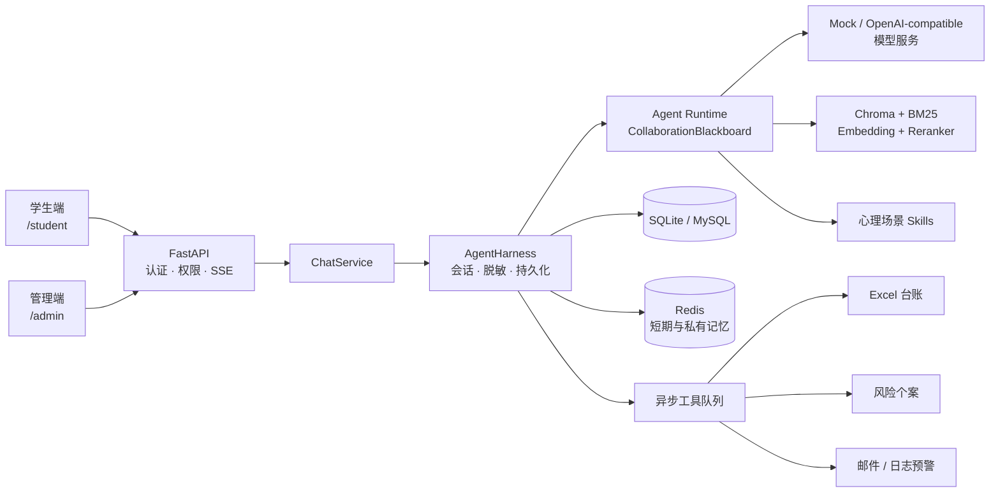

<div align="center">

# 🌿 MindNook

**面向校园场景的多智能体心理支持与风险协作系统**

从学生流式对话，到风险识别、知识检索、报告生成、个案跟进与审计留痕，构建一个可本地运行的完整闭环。

<p>
  
  
  
  
</p>

[快速开始](#-快速开始) · [核心能力](#-核心能力) · [系统架构](#-系统架构) · [配置模型](#-配置模型) · [测试验证](#-测试与评测) · [项目文档](#-项目文档)

</div>

> [!IMPORTANT]
> MindNook 提供心理支持与校园工作协作能力，不进行医学诊断，也不能替代心理咨询、医疗服务或紧急救援。本项目当前用于本地开发和封闭演示，不应直接用于真实危机干预或生产环境。

## ✨ 项目简介

MindNook 是一个前后端一体的校园心理关怀 Web 应用。学生可以在独立会话中获得流式支持回复；系统在后台完成隐私脱敏、风险分级、多智能体协作和本地知识检索；授权管理员可以处理心理支持报告、风险个案、预警、审计记录和运行轨迹。

系统默认使用确定性的 Mock 模型与 SQLite，因此无需模型 API 或容器即可启动。需要完整基础设施时，可切换到 MySQL、Redis 和任意 OpenAI-compatible 模型服务。

## 🚀 核心能力

| 能力 | 实现 |
|---|---|
| 💬 学生支持空间 | 学生注册与登录、多会话管理、SSE 流式回复、历史对话与主动停止生成 |
| 🧠 多智能体协作 | Understanding、Safety、Context、Response Agent 通过追加式黑板协议完成理解、审查、检索和回复 |
| 🛡️ 风险安全 | `CHAT` / `CONSULT` / `RISK` 三级路由，固定高风险规则提供不可被模型降级的安全下限 |
| 🔎 本地混合 RAG | Markdown 知识库、Chroma 向量召回、BM25、加权融合、Cross-Encoder 重排与相邻上下文扩展 |
| 🧩 场景 Skills | 7 个内置心理支持 Skill，支持启动校验、按主题加载、安全降级和管理员状态查看 |
| 🗂️ 管理闭环 | 报告、个案分配、状态流转、跟进记录、邮件/日志预警、Excel 导出与用户管理 |
| 🔐 隐私与审计 | PII 入模前脱敏、角色权限隔离、敏感原文访问与导出审计、完整 Agent Trace |
| ⚙️ 工具治理 | 持久化任务 DAG、幂等、重试、限流、死信记录，以及 6 个 FastMCP stdio 工具 |

## 🧭 系统架构



一轮对话的核心协作链路：

```text
CoordinatorAgent
  → UnderstandingAgent：识别意图、主题与知识需求
  → SafetyAgent：评估风险并发布安全覆盖
  → ContextAgent：加载记忆、RAG 证据与 Skills
  → ResponseAgent：生成候选回复
  → SafetyAgent：复核并按需触发修复
  → CoordinatorAgent：发布 FINAL_ADOPTED
```

所有 Task、Artifact、Message 和 Event 都采用追加式记录。候选回复被修复时会保留历史版本，便于在管理端回溯完整决策过程。

## 🧰 技术栈

| 层级 | 技术 |
|---|---|
| 后端 | Python 3.11+、FastAPI、Uvicorn、SQLAlchemy |
| 前端 | 原生 HTML、CSS、JavaScript |
| 数据与记忆 | SQLite / MySQL、Redis、Chroma |
| AI 与检索 | OpenAI-compatible API、FastEmbed、BGE Embedding、BM25、BGE Reranker |
| 通信与工具 | Server-Sent Events、FastMCP、openpyxl、SMTP |
| 测试 | unittest、pytest、自包含 Engineering Harness |

## ⚡ 快速开始

### 环境要求

- Python `3.11+`
- pip
- Docker 与 Docker Compose（仅完整基础设施模式需要）

### 方式一：轻量本地运行

该方式使用默认 SQLite 和 Mock 模型，不要求模型密钥，也不要求启动 MySQL。

**Windows PowerShell**

```powershell
py -3.11 -m venv .venv
.venv\Scripts\Activate.ps1
python -m pip install -r requirements.txt
uvicorn app.main:app --reload --port 8080
```

**macOS / Linux**

```bash
python3.11 -m venv .venv
source .venv/bin/activate
python -m pip install -r requirements.txt
uvicorn app.main:app --reload --port 8080
```

> [!NOTE]
> 默认 RAG 使用 FastEmbed。首次触发知识检索时可能需要下载 BGE 模型并缓存到 `data/models/`；下载或向量服务不可用时，基础聊天与高风险安全回复仍可降级运行。

### 方式二：MySQL + Redis

复制完整配置并启动基础设施：

```powershell
# Windows PowerShell
Copy-Item .env.example .env
docker compose up -d mysql redis
uvicorn app.main:app --reload --port 8080
```

```bash
# macOS / Linux
cp .env.example .env
docker compose up -d mysql redis
uvicorn app.main:app --reload --port 8080
```

MySQL 默认映射到宿主机 `3307`，Redis 使用 `6379`。修改 `MYSQL_HOST_PORT` 时，请同步调整 `.env` 中的 `DATABASE_URL`。

检查或停止基础设施：

```bash
docker compose ps
docker compose exec redis redis-cli ping
docker compose exec mysql mysqladmin ping -h localhost -uroot -proot-local
docker compose down
```

`docker compose down` 会停止容器但保留数据卷。Python 后端始终在宿主机运行，项目不提供后端 Dockerfile。

### 访问入口

| 入口 | 地址 | 本地演示账号 |
|---|---|---|
| 学生端 | <http://127.0.0.1:8080/student> | `student` / `student123` |
| 管理端 | <http://127.0.0.1:8080/admin> | `admin` / `admin123` |
| OpenAPI | <http://127.0.0.1:8080/docs> | — |
| 健康检查 | <http://127.0.0.1:8080/health/ready> | — |

应用首次启动时会创建数据表、执行兼容迁移并写入演示账号。默认账号与密钥仅限本地开发，任何正式部署都必须更换。

## 🤖 配置模型

默认配置无需网络模型服务：

```dotenv
MODEL_PROVIDER=mock
```

切换到阿里百炼或其他 OpenAI-compatible API：

```dotenv
MODEL_PROVIDER=openai_compatible
MODEL_BASE_URL=https://dashscope.aliyuncs.com/compatible-mode/v1
MODEL_API_KEY=your-api-key
MODEL_NAME=qwen-plus
```

`bailian` 仍可作为 `MODEL_PROVIDER` 的兼容别名。Understanding、Safety 和 Response Agent 也可以通过 `MODEL_UNDERSTANDING_NAME`、`MODEL_SAFETY_NAME`、`MODEL_RESPONSE_NAME` 分别指定模型。

常用配置：

| 配置项 | 默认值 | 说明 |
|---|---|---|
| `DATABASE_URL` | `sqlite:///./mindnook.db` | 业务数据库连接 |
| `REDIS_URL` | `redis://127.0.0.1:6379/0` | 短期记忆与 Agent 私有记忆 |
| `MODEL_PROVIDER` | `mock` | `mock`、`openai_compatible` 或 `bailian` |
| `MODEL_MAX_CALLS_PER_RUN` | `7` | 单轮最大模型调用次数 |
| `AGENT_MAX_ROUNDS` | `16` | 单轮最大协作轮数 |
| `RAG_KNOWLEDGE_DIR` | `data/knowledge` | Markdown 知识目录 |
| `RAG_CHROMA_PATH` | `data/chroma` | Chroma 持久化目录 |
| `EXCEL_LEDGER_PATH` | `data/exports/mindnook-risk-ledger.xlsx` | 风险台账输出路径 |
| `SMTP_HOST` | 空 | 留空时使用本地日志预警 |

全部配置及说明见 [.env.example](.env.example)。

## 🧪 测试与评测

运行全部单元与集成测试：

```bash
python -m unittest discover -s tests
# 或
pytest
```

运行隔离的六类工程验证：

```bash
python -m app.harness.runner
python -m app.harness.runner --json
python -m app.harness.runner --suite risk-safety --suite tool-queue
```

Harness 使用临时 SQLite、内存短期记忆、确定性 Mock 模型、临时 RAG 索引和临时 Excel 文件，不会读写已配置的业务数据库、Redis 或风险台账。

运行 108 条中文样例的 RAG 回归评测：

```bash
python -m app.rag.evaluation
python -m app.rag.evaluation --strict
python -m app.rag.evaluation --evaluate-answers --strict
```

`--strict` 会在任一硬性阈值不达标时返回非零状态，适合接入 CI。自动指标只用于发现回归，真实模型上线前仍需进行心理安全与回答质量人工盲审。

## 🗂️ 项目结构

```text
MindNook/
├── app/
│   ├── agents/          # 多智能体 Runtime 与黑板协议
│   ├── api/             # 认证、学生端与管理端 API
│   ├── harness/         # 聊天编排与工程验证
│   ├── memory/          # 短期、私有与审计记忆
│   ├── mcp/             # FastMCP Server 与示例 Client
│   ├── rag/             # 混合检索、重排与评测
│   ├── services/        # 模型、任务、隐私与报告服务
│   ├── static/          # 学生端与管理端页面
│   └── main.py          # FastAPI 应用入口
├── data/
│   ├── evaluation/      # RAG 评测集、报告与人工评审表
│   └── knowledge/       # 中文心理支持知识库
├── docs/                # 产品与技术文档
├── skills/              # 心理场景 Skill 资产
├── tests/               # 单元与集成测试
├── .env.example         # 完整配置示例
└── docker-compose.yml   # MySQL 与 Redis
```

## 🔌 MCP 工具

启动 stdio MCP Server，或使用示例客户端按风险等级执行报告工具链：

```bash
python -m app.mcp.server
python -m app.mcp.client <report_public_id> --risk RISK
```

MCP 与后台队列复用同一业务层，覆盖 Excel 台账、个案创建、预警发送与确认、个案备注等操作。

## 🔐 安全与隐私边界

- 手机号、邮箱和身份证号等信息会在进入模型与 Redis 短期记忆前脱敏。
- 明确的高风险表达由固定规则优先识别，模型不能将其降级为普通聊天。
- `RISK` 场景可能创建风险个案并触发邮件或日志预警，由授权人员继续处理。
- 管理端查看敏感上下文、导出数据、处理个案和查看 Agent Trace 等操作会留下审计记录。
- 对话、报告、个案、导出文件与运行轨迹都可能包含敏感信息，应实行最小权限和受控保留。

> [!CAUTION]
> 生产部署前至少需要替换默认账号与密钥、采用正式密码算法和会话机制、限制 CORS、加固上传校验、配置数据加密与备份、建立审计和危机响应流程，并由心理专业人员与安全团队共同验收。
