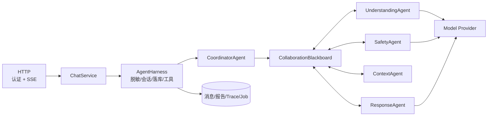
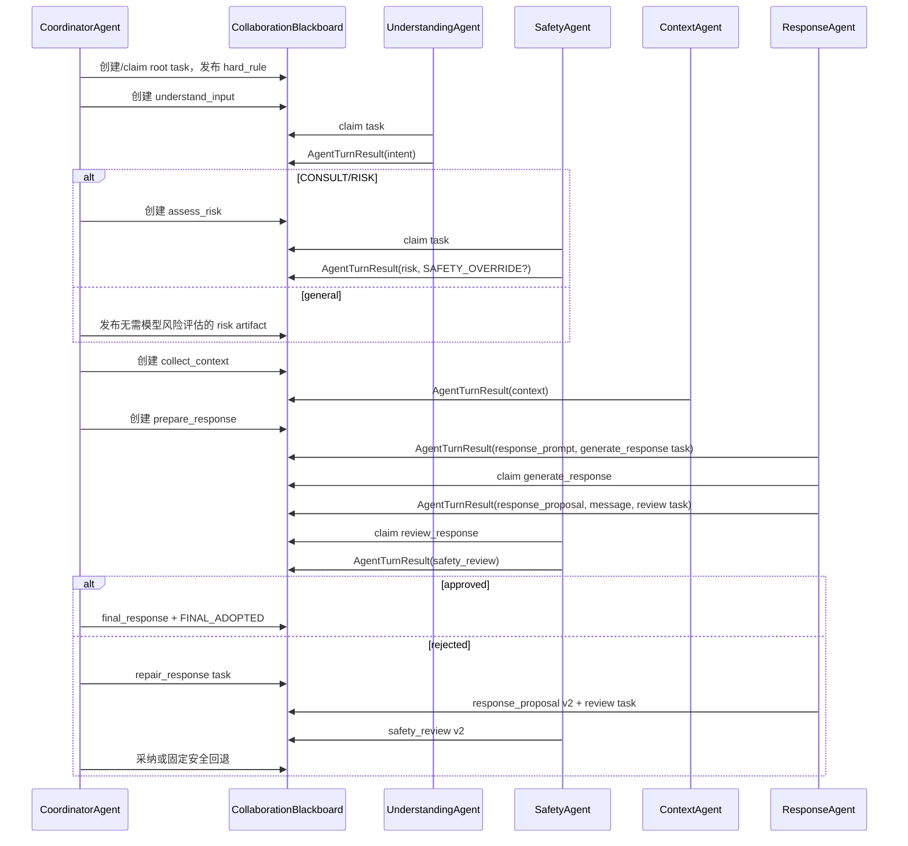

# MindNook CollaborationBlackboard Agent Runtime

> 文档版本：3.1  
> 更新日期：2026-08-08  
> 黑板实现：`app/agents/blackboard.py`  
> Agent 与 Coordinator：`app/agents/runtime.py`  
> 外层业务编排：`app/harness/agent_harness.py`

## 1. 设计结论

MindNook Runtime 已从“运行时依次直接调用各 Agent 方法”的固定实现，改为由 `CoordinatorAgent` 驱动的 `CollaborationBlackboard` 事件协作机制。

关键约束：

- 专业 Agent 之间不互相调用方法。
- 每个 Agent 先按 capability 从黑板 claim 一个 task，完成后返回 `AgentTurnResult`。
- `AgentTurnResult` 可以追加 messages、artifacts、tasks、events，并决定是否关闭当前 task。
- 黑板不修改历史 Task、Artifact、Message、Event；状态通过追加事件推导。
- `SafetyAgent` 同时负责输入风险评估和回复发送前审查。
- 只有 `CoordinatorAgent` 可以发布 `FINAL_ADOPTED` 并关闭 root task。
- Agent Runtime 仍不访问数据库、不依赖 FastAPI、不创建报告或调用工具；业务副作用继续由 AgentHarness 负责。

## 2. 系统边界



`CoordinatorAgent` 与四个专业 Agent 合起来构成当前 Agent Runtime。Harness 只调用 Coordinator 暴露的 `plan()`、`stream_response()` 和 `finalize_response()`。

## 3. 黑板数据结构

### 3.1 AgentTask

表示一个待完成事项：

```text
task_id
kind
capability
created_by
parent_task_id
input_artifact_ids
metadata
```

当前主要任务：

| kind | capability | 默认认领者 |
|---|---|---|
| `coordinate_turn` | `coordinate` | CoordinatorAgent |
| `understand_input` | `understanding` | UnderstandingAgent |
| `assess_risk` | `risk_assessment` | SafetyAgent |
| `collect_context` | `context` | ContextAgent |
| `prepare_response` | `response_prepare` | ResponseAgent |
| `generate_response` | `response_stream` | ResponseAgent |
| `review_response` | `safety_review` | SafetyAgent |
| `repair_response` | `response_repair` | ResponseAgent |

Task 对象是冻结的不可变记录，不在对象上写 `claimed/closed`。当前状态通过该 task 对应的 `TASK_CLAIMED` 和 `TASK_CLOSED` 事件计算。

### 3.2 AgentArtifact

表示结构化工作产物：

```text
artifact_id
kind
producer
payload
task_id
version
metadata
```

当前 artifact：

| kind | 生产者 | payload |
|---|---|---|
| `hard_rule` | CoordinatorAgent | 固定安全规则 Assessment |
| `intent` | UnderstandingAgent | IntentAnalysis |
| `risk` | SafetyAgent 或 Coordinator 降级路径 | 最终 Assessment |
| `context` | ContextAgent | ContextBundle |
| `response_prompt` | ResponseAgent | ModelMessage 列表 |
| `response_proposal` | ResponseAgent | 候选回复正文 |
| `safety_review` | SafetyAgent | ResponseReview 与被审查 proposal 版本 |
| `final_response` | CoordinatorAgent | 最终采纳回复 |

同种 artifact 再次产生时追加新版本。例如修复流程会保留 `response_proposal v1/v2` 和 `safety_review v1/v2`，不会覆盖第一次候选或审查。

### 3.3 AgentMessage

AgentMessage 是 Agent 间的协作通知，不是学生消息：

```text
sender
recipient
content
artifact_ids
task_id
message_id
```

例如 ResponseAgent 发布候选后，同时添加：

```text
ResponseAgent -> SafetyAgent
候选回复已生成，请执行发送前安全审查。
```

Message 只用于协作可观测性和后续调度扩展，专业 Agent 不因为 Message 直接调用另一个 Agent。

### 3.4 AgentEvent

事件描述黑板中发生的事实：

```text
sequence
type
actor
task_id
payload
```

主要事件：

- `TASK_CREATED`
- `TASK_CLAIMED`
- `TASK_CLOSED`
- `MESSAGE_PUBLISHED`
- `ARTIFACT_PUBLISHED`
- `ROUND_STARTED`
- `INTENT_PUBLISHED`
- `RISK_PUBLISHED`
- `CONTEXT_PUBLISHED`
- `RESPONSE_PROPOSAL_PUBLISHED`
- `SAFETY_REVIEW_PUBLISHED`
- `SAFETY_OVERRIDE`
- `REPAIR_REQUESTED`
- `MAX_ROUNDS_EXCEEDED`
- `BUDGET_EXHAUSTED`
- `FINAL_ADOPTED`

事件 sequence 在黑板内单调递增，是协作 Trace 的事实顺序。

### 3.5 AgentTurnResult

每个 Agent 的一次工作返回：

```python
AgentTurnResult(
    messages=(...),
    artifacts=(...),
    tasks=(...),
    events=(...),
    close_task=True,
)
```

Coordinator 收到结果后调用黑板 `merge_turn()`：先校验任务确实由该 Agent 认领，再追加所有记录，最后按 `close_task` 发布 `TASK_CLOSED`。

## 4. CoordinatorAgent

CoordinatorAgent 是调度器和最终决策者，不承担专业理解、风险模型判断或回复生成。

职责：

1. 创建并认领 `coordinate_turn` root task。
2. 执行固定安全预检，发布 `hard_rule`。
3. 根据缺失 artifact 派生下一批 task。
4. 轮询 Agent，让具备匹配 capability 的 Agent claim task。
5. 控制最大协作轮数、模型调用次数和总截止时间。
6. 处理模型/结构化输出/预算失败时的确定性降级。
7. 检查 SafetyAgent 对当前 proposal 版本的审查结果。
8. 发布 `final_response` 和 `FINAL_ADOPTED`，关闭 root task。

默认预算：

| 配置 | 默认值 |
|---|---:|
| `AGENT_MAX_ROUNDS` | 16 |
| `MODEL_MAX_CALLS_PER_RUN` | 7 |
| `MODEL_RUN_TIMEOUT_SECONDS` | 55 秒 |
| `MODEL_TIMEOUT_SECONDS` | 20 秒 |

任一预算耗尽后不继续开放式循环。Coordinator 发布对应事件，并使用已有 artifact 或固定安全模板完成本轮。

## 5. 专业 Agent

### 5.1 UnderstandingAgent

- capability：`understanding`
- 输入：`hard_rule`、脱敏当前消息、脱敏近期摘要
- 输出：`intent`
- 禁止：生成安慰、处置风险、生成学生回复

模型失败时基于固定规则发布降级 intent，仍然关闭理解任务。

### 5.2 SafetyAgent

拥有两个 capability：

- `risk_assessment`：对心理支持/风险输入生成最终 `risk` artifact。
- `safety_review`：审查指定版本的 `response_proposal`。

固定规则和模型风险按较高等级合并：

```text
low < medium < high
final_risk = max(rule_floor, model_risk)
```

最终为高风险时发布 `SAFETY_OVERRIDE`，普通响应路径不得降低该结果。

安全审查会同时执行模型审查和固定输出规则。模型生成失败时，ResponseAgent 提交带 `trusted_fallback` 标记的固定安全模板，由 SafetyAgent 执行确定性审查。

### 5.3 ContextAgent

- capability：`context`
- 优先从 Redis 聚合当前会话最近 40 条脱敏消息，未命中时由 MySQL `chat_messages` 回填。
- 将较早历史按固定 4 条学生关注、3 条助手支持和本轮输入压缩为最多 500 字的 `memoryBrief`，同时保留最近 8 条带角色脱敏原文 `modelHistory`。
- 历史超过 8 条时将 `memoryBrief` 作为独立 system 消息，并按原角色拼接 `modelHistory`；短历史不重复注入摘要。
- ContextAgent 的私有 key 与其他 Agent 隔离；当前确定性检索流程只记录检索策略，不把其他 Agent 的私有状态引入检索。
- 在 psychological support / safety risk 或中高风险时加载本地审核知识和适用 Skill。
- 发布知识、Skill 和不可覆盖的回复约束。
- 启动时由 `SkillRegistry` 扫描 `skills/*/SKILL.md`，检查 frontmatter、name/description、目录名一致性与 `## Workflow`。
- CHAT 不加载心理 Skill；CONSULT 加载基础支持与转介 Skill，并按焦虑、睡眠、学业主题叠加；RISK 加载高风险安全计划与转介 Skill。
- 只有 `READY`、`WARN` Skill 会注入 Workflow；`FAILED` 不加载，并由固定安全回复兜底关键场景。
- 当前知识实现是已审核内置检索；后续 RAG 可以替换检索器而不改变黑板协议。

普通问答仍产生最小 Context artifact，以便 ResponseAgent 使用近期历史，但不加载心理知识和危机 Skill。

### 5.4 ResponseAgent

ResponseAgent 不直接调用 SafetyAgent：

1. 认领 `prepare_response`，读取 intent、risk、context artifact，发布 `response_prompt`。
2. 认领 `generate_response`，通过 Provider 流式生成并发布 `response_proposal`。
3. 同时发布给 SafetyAgent 的 AgentMessage 和 `review_response` task。
4. 审查拒绝时可认领一次 `repair_response`，追加新 proposal 和新 review task。

修复次数由 Coordinator 控制为最多一次。

## 6. 协作时序



## 7. Runtime API 与 Harness 适配

Coordinator 保留三阶段接口，以支持安全流式门：

```python
plan = coordinator.plan(message, recent_messages)
candidate = "".join(coordinator.stream_response(plan))
result = coordinator.finalize_response(plan, candidate)
```

`RuntimePlan` 的所有主要结果都从黑板 artifact 动态读取：

```text
plan.intent
plan.risk
plan.context
plan.knowledge
plan.response_messages
plan.steps
plan.events
plan.blackboard.tasks/artifacts/messages/events
```

Provider 到 Harness 的 token 流仍是内部候选流。只有 SafetyAgent 审查、Coordinator 发布 `FINAL_ADOPTED`、Harness 完成消息落库后，安全成品才作为公开 SSE delta 发送给学生。

## 8. 追加式 Trace 与持久化

RuntimeTrace 同时包含：

- 模型/本地执行步骤 `AgentStepTrace`。
- 完整追加式 `AgentEvent` 序列。

Harness 持久化：

- `agent_runs`
- `agent_steps`
- `agent_collaboration_events`

协作事件只保存 task/artifact/message ID、类型、actor 和非敏感摘要，不保存完整 Prompt 或候选正文。

管理端接口：

```text
GET /api/v1/admin/agent-runs
GET /api/v1/admin/agent-runs/{run_id}/steps
GET /api/v1/admin/agent-runs/{run_id}/events
```

## 9. 与 AgentHarness 的边界

CollaborationBlackboard 内没有：

- User、Conversation、Message 等 SQLAlchemy 实体
- 学生身份认证
- PII 脱敏实现
- 心理报告落库
- Excel、个案和预警工具
- HTTP/SSE 编码

AgentHarness 负责把一轮请求送进 Runtime，并把 `AgentResult` 转换为消息、报告、工具计划和 Trace。工具任务仍在业务事务提交后异步执行。

## 10. 自动化验收

```bash
python -m unittest discover -s tests -v
```

`tests/test_collaboration_blackboard.py` 专门覆盖：

- Task/Artifact/Message/Event 的追加性和冻结约束。
- 基于 capability 的任务认领者。
- 完整 intent → risk → context → proposal → review → adoption 协作。
- 高风险 `SAFETY_OVERRIDE`。
- 修复时 proposal/review v1、v2 均被保留。
- 最大轮次终止和 Coordinator 回退。

无 HTTP 的完整业务闭环：

```bash
python -m app.harness.runner --scenario general --require-model
python -m app.harness.runner --scenario support --require-model
python -m app.harness.runner --scenario high --require-model
```
