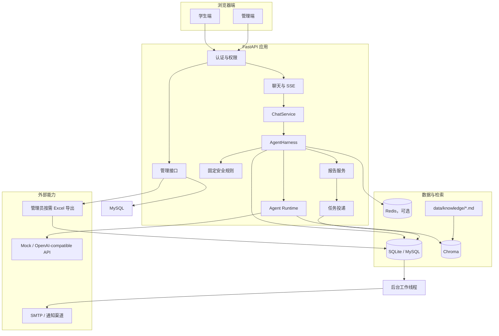
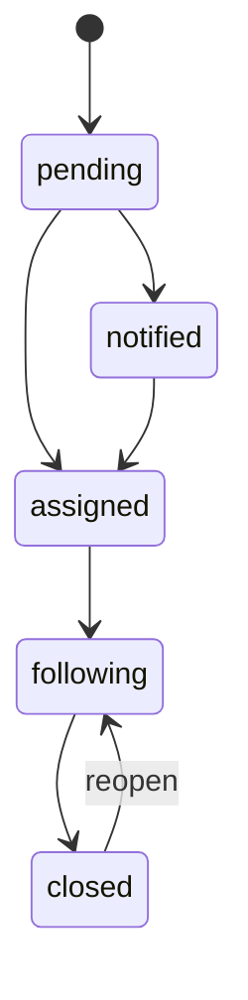
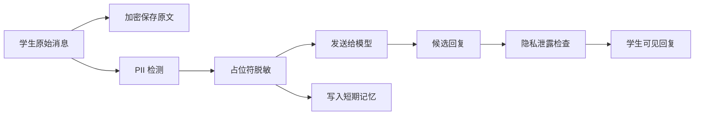
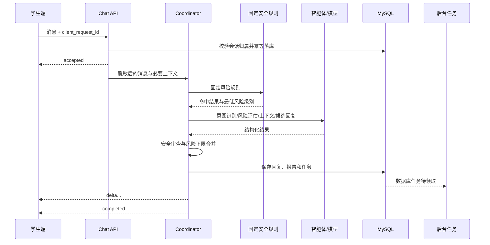

# MindNook 技术实施方案（历史蓝图与现状对照）

> 文档版本：1.1
> 编制日期：2026-07-30
> 现状复核日期：2026-08-24
> 依据文档：[PRD.md](./PRD.md)、[TECHNICAL.md](./TECHNICAL.md)
> 适用范围：MindNook 校园心理健康问答系统的设计、开发、测试、部署与上线验收

---

## 0. 阅读说明

本文最初用于编码前的目标设计与阶段规划，保留了上线治理和后续能力蓝图，不是当前仓库结构或已完成功能清单。当前事实优先级为：代码与自动化测试 → 对应模块文档 → [技术总览](./TECHNICAL.md) → 本实施方案。

当前代码基线：

| 领域 | 当前实现 |
|---|---|
| 风险枚举 | `CHAT / CONSULT / RISK`；不存在现行业务枚举 `low / medium / high` |
| 业务副作用 | `CHAT` 无；`CONSULT` 报告 + SQL 台账登记；`RISK` 报告 + SQL 台账登记 + 个案 + 预警 |
| 数据库 | 代码默认 SQLite，可配置 MySQL；应用启动执行兼容迁移和 `create_all()`，没有 Alembic 目录 |
| 知识 | `data/knowledge` 第一层 Markdown + Chroma/BM25；管理 API 只有状态、来源和重建 |
| 角色 | 只有 `student` 与 `admin`；没有细粒度组织或资源范围授权 |
| 部署 | Compose 只启动 MySQL 与 Redis；FastAPI 在宿主机运行 |
| 尚未实现的目标态 | 知识上传/审核/版本快照、SSO/MFA、Token 撤销、独立 Worker、字段级加密、资源级权限、正式数据生命周期和上线审批材料 |

以下章节凡与上表或当前模块文档不同，均按“历史设计/目标态”阅读，不能直接作为当前 API、Schema 或部署操作依据。

## 1. 实施目标

本方案用于把产品需求拆解为可直接编码、测试和验收的技术任务。首个可用版本需要同时满足三条主线：

1. 学生能够安全、稳定地进行普通问答和心理支持对话。
2. `CONSULT` 和 `RISK` 对话形成内部报告与台账；只有 `RISK` 自动进入个案流程，并在个案任务成功后触发异步预警。
3. 管理员能够在授权范围内维护知识、查看报告、处理个案、追踪异常和审计敏感操作。

MindNook 是辅助支持系统，不提供临床诊断、药物建议或治疗方案。风险识别结果仅用于安全响应和人工跟进，不作为处分、诊断或强制决策的唯一依据。

### 1.1 实施原则

- **安全优先**：明确自伤、自杀、伤人和即时危险表达由固定规则优先识别，模型不得将其降级。
- **回复优先**：保存报告、写入台账、创建个案和发送预警不得阻塞学生获得回复。
- **最小披露**：学生端不显示风险等级、评分、模型置信度、报告或后台处理状态。
- **服务降级**：Redis、Chroma、Embedding、邮件或后台任务异常时，基础对话和高风险安全回复仍应尽可能可用。
- **事实可追溯**：校园联系方式、服务时间和转介政策必须来自已审核、未过期的知识来源；缺少可信内容时明确提示联系校方确认，不得编造。
- **服务端授权**：所有权限和数据归属在后端校验，不能依赖前端隐藏。
- **幂等执行**：聊天提交、报告、台账、个案和预警均需要业务幂等键。
- **可审计**：敏感信息查看、个案变更、知识发布、导出和系统配置变更保留审计记录。

### 1.2 版本边界

建议分为三个交付层级：

| 层级 | 目标 | 主要范围 |
|---|---|---|
| MVP | 跑通安全闭环 | 登录、SSE 对话、三分类、风险硬规则、报告、个案、邮件/日志预警、基础管理台、审计 |
| Beta | 提升可用性和知识质量 | 混合检索、知识审核发布、记忆摘要、任务死信处理、可观测性、完整权限 |
| Production | 满足正式校园部署要求 | SSO/MFA、合规策略、数据生命周期、加密与密钥管理、灾备、压测、安全与伦理审核 |

本方案默认保留普通学习、编程和校园问答能力，但通过路由明确绕开心理评估和心理知识检索。若产品最终取消普通问答，只需关闭对应功能开关，不改变风险链路。

系统只建设两个用户端：

- **学生端**：登录、创建会话、进行问答、查看自己的历史会话。
- **管理端**：报告、个案、知识库、预警、异常任务、审计和系统配置管理。

后端角色也只保留 `student` 和 `admin`。心理跟进、知识维护和系统运维均通过管理端完成，不拆分其他独立角色或用户端。

---

## 2. 待确认事项与实施假设

PRD 中尚未确定的事项不能通过代码“猜测”。开发阶段统一进入配置或功能开关，上线前必须由学校确认。

| 待确认项 | 开发期默认假设 | 上线前要求 |
|---|---|---|
| 角色划分 | 仅保留 `student` 和 `admin` 两种角色 | 明确管理员的数据访问范围和审批人 |
| 普通问答 | 默认开启 | 由产品负责人确认是否保留 |
| 风险标准 | 使用当前 `CHAT / CONSULT / RISK` 三级和固定规则下限 | 经心理、法律、伦理负责人书面审核 |
| 原始对话访问 | 仅管理员在处理相关个案时可查看必要上下文 | 明确合法依据、访问范围和留痕规则 |
| 数据保存期限 | 配置项存在，但不自动物理删除 | 确认保留、归档、匿名化和删除期限 |
| 校园资源 | 初始为空，不内置虚构电话和办公时间 | 由学校提供并审核后发布 |
| 通知渠道 | 本地为日志，测试/生产可启用 SMTP | 明确接收人、值守时间、升级路径和时限 |
| 个案流程 | 使用建议状态机 | 由实际工作流程负责人确认 |
| 匿名使用 | MVP 不支持 | 单独完成身份、风险跟进和隐私评审 |
| 人工转接 | MVP 提供现实求助指引，不做在线即时转接 | 若需要，新增排班、会话接管和 SLA 设计 |

在上述事项未完成前，系统可以用于本地演示和封闭测试，但不得声明已具备正式心理危机干预能力。

---

## 3. 总体技术架构

### 3.1 逻辑架构



### 3.2 关键实现决策

#### 单体优先、边界清晰

首版采用模块化单体 FastAPI 应用，避免在需求尚未稳定时引入微服务运维成本。聊天、报告、知识、个案、任务和审计保持清晰模块边界，后续可按负载拆分。

聊天主链路固定为 `HTTP -> ChatService -> AgentHarness -> Agent Runtime`。HTTP 只负责认证和 SSE；ChatService 只过滤公开事件；Harness 统一处理输入脱敏、会话解析、Runtime run、消息/报告/Trace 落库和工具计划；Runtime 只产出 `intent/risk/knowledge/response_messages/steps/events`，不接触 FastAPI 和数据库。

#### 数据库是事实数据源

- 当前 SQLAlchemy 业务数据库保存用户、会话、消息、报告、个案、任务和审计；代码默认 SQLite，`.env.example` 选择 MySQL。
- Redis 只用于可丢失的会话近期记忆和 Agent 私有记忆；工具预警限流当前使用进程内滑动窗口。
- Chroma 保存可重建的向量索引，知识 Chunk 与 BM25 索引由 RAG 服务在内存维护，不写业务数据库。
- `psychological_reports` 保存台账详细数据，`ledger_entries` 保存每份报告的唯一登记标记；管理员需要文件时从 SQL 即时生成 Excel。

#### 数据库支持的进程内任务队列

TECHNICAL 指定“进程内任务队列与线程池”，同时要求任务可重试并在服务重启后恢复。实现时采用：

1. 业务事务内向 `tool_jobs` 表写入任务。
2. Dispatcher 按优先级领取到期的 `PENDING` 任务并置为 `RUNNING`。
3. 分类型线程池执行个案和通知操作。
4. 执行结果写为 `SUCCESS`，失败按指数退避回到 `PENDING`，超过次数进入 `DEAD` 并写 `dead_letter_records`。
5. 应用启动时将遗留的全部 `RUNNING` 任务恢复为 `PENDING`。

仅放在 Python 内存队列中的任务无法满足重启恢复要求，因此内存队列只能用于唤醒 worker，不能作为唯一存储。

#### 高风险同步识别、后台动作异步执行

风险硬规则、风险评估、安全回复和回复审查处于学生请求主链路；报告后续的台账、个案和预警处于异步链路。高风险时必须先在同一数据库事务内保存消息、报告和待执行任务，再向学生完成 SSE 结束事件。

---

## 4. 推荐代码结构

> 本节目录树是早期目标结构，不是当前仓库清单。当前项目没有 Repository 层、Alembic `migrations/`、拆分后的 reports/cases/knowledge API 文件或该测试分层；实际结构请以仓库和 [技术总览](./TECHNICAL.md) 为准。

```text
MindNook/
├─ app/
│  ├─ main.py
│  ├─ api/
│  │  ├─ dependencies.py
│  │  ├─ auth.py
│  │  ├─ chat.py
│  │  ├─ reports.py
│  │  ├─ cases.py
│  │  ├─ knowledge.py
│  │  ├─ admin_operations.py
│  │  └─ health.py
│  ├─ core/
│  │  ├─ config.py
│  │  ├─ security.py
│  │  ├─ logging.py
│  │  ├─ errors.py
│  │  └─ constants.py
│  ├─ harness/
│  │  ├─ agent_harness.py
│  │  └─ runner.py
│  ├─ models/
│  │  ├─ user.py
│  │  ├─ conversation.py
│  │  ├─ message.py
│  │  ├─ report.py
│  │  ├─ case.py
│  │  ├─ knowledge.py
│  │  ├─ job.py
│  │  ├─ agent_trace.py
│  │  └─ audit.py
│  ├─ schemas/
│  │  ├─ auth.py
│  │  ├─ chat.py
│  │  ├─ report.py
│  │  ├─ case.py
│  │  ├─ knowledge.py
│  │  └─ common.py
│  ├─ repositories/
│  │  ├─ conversations.py
│  │  ├─ reports.py
│  │  ├─ cases.py
│  │  ├─ jobs.py
│  │  └─ knowledge.py
│  ├─ services/
│  │  ├─ auth_service.py
│  │  ├─ chat_service.py
│  │  ├─ privacy_service.py
│  │  ├─ memory_service.py
│  │  ├─ knowledge_service.py
│  │  ├─ report_service.py
│  │  ├─ case_service.py
│  │  ├─ notification_service.py
│  │  ├─ ledger_service.py
│  │  └─ audit_service.py
│  ├─ agents/
│  │  ├─ protocol.py
│  │  ├─ understanding.py
│  │  ├─ safety.py
│  │  ├─ context.py
│  │  ├─ response.py
│  │  ├─ runtime.py
│  │  └─ prompts/
│  ├─ safety/
│  │  ├─ rules.py
│  │  ├─ classifier.py
│  │  ├─ response_guard.py
│  │  └─ fallback.py
│  ├─ rag/
│  │  ├─ loader.py
│  │  ├─ chunker.py
│  │  ├─ embeddings.py
│  │  ├─ bm25.py
│  │  ├─ fusion.py
│  │  ├─ reranker.py
│  │  └─ index_manager.py
│  ├─ workers/
│  │  ├─ dispatcher.py
│  │  ├─ executor.py
│  │  └─ handlers/
│  ├─ knowledge/
│  │  └─ builtin/
│  └─ static/
│     ├─ student/
│     │  └─ login.html
│     └─ admin/
│        └─ login.html
├─ skills/
│  ├─ general_support.md
│  ├─ anxiety_support.md
│  ├─ sleep_support.md
│  └─ crisis_response.md
├─ migrations/
├─ tests/
│  ├─ unit/
│  ├─ integration/
│  ├─ contract/
│  ├─ safety/
│  └─ e2e/
├─ scripts/
├─ data/
│  ├─ chroma/
│  ├─ snapshots/
│  └─ exports/
├─ .env.example
├─ docker-compose.yml
└─ pyproject.toml
```

约束：

- API 层只做参数验证、认证授权、调用服务和响应转换，不直接写复杂业务逻辑。
- AgentHarness 是聊天业务用例的唯一编排入口；自动化验收可以直接调用它，不依赖 HTTP Request。
- Agent Runtime 不能导入 FastAPI、SQLAlchemy 模型或后台工具，只处理模型输入与结构化推理结果。
- Repository 封装数据访问；Service 管理事务和业务规则。
- Prompt、风险词典、回复模板和校园资源分离管理，不把大段规则硬编码在路由中。
- 所有数据库结构变更通过迁移脚本完成，不在应用启动时隐式修改生产表。
- `.env.example`、Compose 和其他环境配置保留在项目根目录，不放入说明文档目录；后端不提供 Dockerfile。

---

## 5. 领域模型与数据库设计

### 5.1 通用约定

- 主键使用 `BIGINT` 或 UUID，API 对外优先暴露不可枚举的 UUID。
- 所有表包含 `created_at`，可变实体包含 `updated_at`。
- 时间统一以 UTC 存储，前端按 `Asia/Shanghai` 展示。
- 敏感文本字段明确加密或脱敏策略。
- 逻辑删除字段仅用于需要保留审计链的业务；隐私删除使用专门匿名化流程，不能把逻辑删除等同于合规删除。
- 对报告、个案、任务等核心记录保留 `schema_version`，便于后续结构升级。

### 5.2 核心实体

> 本节保留早期目标数据字典。未在下文特别改成“当前”的字段可能尚未实现；当前 ORM 的唯一事实源是 `app/models.py`。

#### `users`

| 字段 | 类型 | 说明 |
|---|---|---|
| `id` | BIGINT PK | 内部主键 |
| `public_id` | CHAR(36) UNIQUE | 对外标识 |
| `username` | VARCHAR(128) UNIQUE | 登录名或学校身份映射 |
| `password_hash` | VARCHAR(255) | Argon2id/bcrypt 摘要；SSO 后可为空 |
| `display_name` | VARCHAR(128) | 展示名 |
| `role` | ENUM | `student/admin` |
| `status` | ENUM | `active/locked/disabled` |
| `failed_login_count` | INT | 连续失败次数 |
| `locked_until` | DATETIME | 锁定截止时间 |
| `last_login_at` | DATETIME | 最近登录时间 |

#### `conversations`

| 字段 | 类型 | 说明 |
|---|---|---|
| `id` | BIGINT PK | 会话主键 |
| `public_id` | CHAR(36) UNIQUE | 对外会话 ID |
| `student_id` | BIGINT FK | 必须为学生 |
| `title` | VARCHAR(255) | 可由首条消息生成 |
| `status` | ENUM | `active/archived` |
| `last_message_at` | DATETIME | 最近消息时间 |
| `memory_summary_ciphertext` | LONGTEXT | 加密的内部摘要 |
| `memory_summary_version` | INT | 摘要版本 |

索引：`(student_id, last_message_at)`。

#### `chat_messages`

| 字段 | 类型 | 说明 |
|---|---|---|
| `id` | BIGINT PK | 消息主键 |
| `public_id` | CHAR(36) UNIQUE | 对外消息 ID |
| `conversation_id` | BIGINT FK | 所属会话 |
| `sender_type` | ENUM | `student/assistant/system` |
| `content_ciphertext` | LONGTEXT | 加密原文 |
| `redacted_content` | LONGTEXT | 脱敏内容，仅在确有需要时保存 |
| `client_request_id` | VARCHAR(64) | 防重复提交 |
| `status` | ENUM | `received/generating/completed/failed` |
| `model_name` | VARCHAR(128) | 助手消息使用的模型 |
| `token_usage_json` | JSON | 令牌统计，不保存密钥 |

唯一约束：学生请求使用 `(conversation_id, client_request_id)`。

#### `psychological_reports`

| 字段 | 类型 | 说明 |
|---|---|---|
| `id` | BIGINT PK | 报告主键 |
| `public_id` | CHAR(36) UNIQUE | 对外报告 ID |
| `conversation_id` | BIGINT FK | 来源会话 |
| `source_message_id` | BIGINT FK UNIQUE | 每条来源消息最多一个报告 |
| `student_id` | BIGINT FK | 学生 |
| `emotion_summary` | TEXT | 事实化概况 |
| `risk_level` | VARCHAR(16) | 当前为 `CONSULT/RISK`；`CHAT` 不生成报告 |
| `confidence` | FLOAT | 后台参考值 |
| `reason_summary` | TEXT | 简短判断理由 |
| `handoff_summary` | TEXT | 事实化交接摘要 |
| `generated_by_ai` | BOOLEAN | 固定为真，便于展示提示 |
| `created_at` | DATETIME | 创建时间 |

索引：`(risk_level, created_at)`、`(student_id, created_at)`。

#### `risk_cases`

| 字段 | 类型 | 说明 |
|---|---|---|
| `id` | BIGINT PK | 个案主键 |
| `public_id` | CHAR(36) UNIQUE | 对外 ID |
| `report_id` | BIGINT FK UNIQUE | 保证同一报告不重复建案 |
| `student_id` | BIGINT FK | 学生 |
| `risk_level` | ENUM | 当前风险级别 |
| `status` | ENUM | `pending/notified/assigned/following/closed` |
| `assignee_id` | BIGINT FK NULL | 负责人 |
| `handoff_summary` | TEXT | 交接摘要 |
| `follow_up_at` | DATETIME NULL | 复访时间 |
| `closed_at` | DATETIME NULL | 关闭时间 |
| `version` | INT | 乐观锁版本 |

#### `case_events`

个案状态变化和备注统一采用追加式事件记录，避免覆盖历史。

| 字段 | 类型 | 说明 |
|---|---|---|
| `case_id` | BIGINT FK | 个案 |
| `event_type` | ENUM | `created/assigned/status_changed/note_added/reopened` |
| `from_status` / `to_status` | ENUM NULL | 状态迁移 |
| `content_ciphertext` | TEXT NULL | 加密备注 |
| `actor_id` | BIGINT FK | 执行该操作的管理员 |
| `occurred_at` | DATETIME | 发生时间 |

#### 目标态：`knowledge_sources` 与 `knowledge_chunks`（当前未实现）

`knowledge_sources` 保存文件、来源、审核、版本、有效期和发布状态；`knowledge_chunks` 保存分块文本、顺序、元数据、BM25 内容和向量索引引用。

知识来源状态：

```text
uploaded -> validating -> processing -> pending_review -> published
                    \-> failed
published -> disabled
```

校园资源类知识额外保存：

- `owner_department`
- `verified_by`
- `verified_at`
- `valid_from`
- `valid_until`
- `source_reference`

过期或未审核资源不得进入学生可见回答。

#### 当前：`tool_jobs`

| 字段 | 类型 | 说明 |
|---|---|---|
| `id` | BIGINT PK | 任务主键 |
| `job_type` | VARCHAR(64) | 报告链路使用 `CASE_CREATE/ALERT_SEND`，业务操作还支持 3 个 MCP 类型 |
| `idempotency_key` | VARCHAR(191) UNIQUE | 业务幂等键 |
| `report_id` | BIGINT NULL | 关联报告 |
| `payload_json` | TEXT | JSON 参数 |
| `status` | VARCHAR(24) | `PENDING/RUNNING/SUCCESS/DEAD` |
| `priority` | INT | `CASE_CREATE=100`、`ALERT_SEND=90` |
| `depends_on_job_id` | BIGINT NULL | 预警依赖个案任务 |
| `attempts` | INT | 已尝试次数（ORM 属性名 `attempt_count`） |
| `max_attempts` | INT | 最大尝试次数，默认 3 |
| `run_after` | DATETIME | 下次执行时间 |
| `locked_by` / `locked_at` | VARCHAR / DATETIME | Worker 领取信息 |
| `last_error` | TEXT | 最近错误 |

高风险任务优先级必须高于普通导出任务。

#### 其他表

- `alert_deliveries`：渠道、接收配置引用、发送状态、频率抑制、外部消息 ID。
- `ledger_entries`：报告到台账的唯一成功记录，`report_id` 唯一。
- 当前 `agent_runs` / `agent_steps` 保存运行摘要；`agent_collaboration_events` 保存协作事件；`agent_run_traces` 还会保存包含 Prompt 与候选正文的完整高敏 Trace。
- 当前 `audit_logs` 保存已接入的敏感读取、导出和重要写操作，但并非所有列表读取都审计。
- `tool_audits`、`refresh_tokens/sessions`、`system_config_versions` 是目标态，当前没有这些表。

### 5.3 个案状态机



校验规则：

- `closed` 必须包含关闭说明和操作人。
- 关闭后新增跟进需要先重新打开。
- 并发更新使用 `version` 乐观锁，冲突返回 `409`。
- 每次状态变化同时写入 `case_events` 和 `audit_logs`。

---

## 6. 认证、授权与隐私实现

### 6.1 环境分级

| 环境 | 认证方式 |
|---|---|
| 当前本地/测试 | PBKDF2 密码摘要 + 自定义 HMAC Bearer Token；可 Seed 演示账号 |
| 生产目标 | 学校 SSO 或正式会话；管理员启用 MFA 或等效强认证 |

以下启动安全检查属于生产目标态，当前代码尚未实现自动拒绝启动：

- 存在公开默认密码。
- 使用简单摘要或明文密码。
- `APP_SECRET`、加密密钥为默认值。
- CORS 配置为任意来源。
- Cookie 未启用 `Secure`、`HttpOnly` 和合适的 `SameSite`。

### 6.2 权限矩阵

| 能力 | student | admin |
|---|---:|---:|
| 发起本人对话 | 是 | 否 |
| 查看本人会话 | 是 | 否 |
| 查看心理报告 | 否 | 是 |
| 查看必要对话背景 | 否 | 是，且必须记录审计 |
| 处理个案 | 否 | 是 |
| 管理知识 | 否 | 是 |
| 查看任务异常 | 否 | 是 |
| 查看服务指标 | 否 | 是 |
| 管理系统配置 | 否 | 是 |

实现上采用 RBAC 加资源级校验：

1. 先检查角色是否拥有动作权限。
2. 再检查当前用户是否有权访问目标学生、会话或个案。
3. 敏感读取成功或拒绝均写审计日志。

管理端内部可以按管理员账号配置具体功能权限和数据范围，但这只是 `admin` 角色下的权限策略，不新增角色，也不建设新的用户端。

### 6.3 隐私处理链



首版至少识别：

- 手机号、邮箱、身份证号、学号候选格式。
- 详细地址、定位信息等可配置模式。
- 由系统已知的真实姓名或身份标识。

脱敏占位符使用稳定的会话内映射，如 `[PHONE_1]`、`[EMAIL_1]`，避免模型失去上下文关系。映射只保留在请求生命周期或受保护的短期存储中。

### 6.4 日志红线

应用日志不得默认记录：

- 完整消息原文。
- 完整模型 Prompt 和回复。
- SMTP 密码、API Key、访问令牌或 Cookie。
- 完整手机号、邮箱、身份证号、学号和定位。

日志使用 `request_id`、`conversation_public_id`、错误码、耗时和状态进行定位。确需查看原文时通过授权业务界面访问并生成审计记录。

---

## 7. 学生对话主链路

### 7.1 接口契约

建议接口：

| 方法 | 路径 | 说明 |
|---|---|---|
| `POST` | `/api/v1/auth/login` | 登录 |
| `POST` | `/api/v1/auth/logout` | 退出 |
| `GET` | `/api/v1/me` | 当前用户与能力 |
| `POST` | `/api/v1/conversations` | 开始新会话 |
| `GET` | `/api/v1/conversations` | 本人的历史会话 |
| `GET` | `/api/v1/conversations/{id}/messages` | 本人会话消息分页 |
| `POST` | `/api/v1/conversations/{id}/messages:stream` | 提交消息并返回 SSE |
| `POST` | `/api/v1/chat/requests/{client_request_id}:retry` | 对失败请求进行幂等重试 |

聊天请求：

```json
{
  "content": "最近考试压力很大，晚上总是睡不着",
  "client_request_id": "018f..."
}
```

服务端不得接受请求体中的 `student_id` 作为授权依据，学生身份从认证上下文获取。

### 7.2 SSE 事件

| 事件 | 数据 | 用途 |
|---|---|---|
| `accepted` | 请求 ID、消息 ID | 已接收，前端禁止重复提交 |
| `status` | `understanding/retrieving/generating/checking` | 展示处理状态，不暴露内部风险判断 |
| `delta` | 文本片段 | 逐步展示回复 |
| `completed` | 助手消息 ID、会话 ID | 正常结束 |
| `error` | 可公开错误码、是否可重试 | 失败处理 |

要求：

- 使用 `text/event-stream`，关闭代理缓冲。
- 每隔合理时间发送心跳，避免网关误断开。
- 客户端断开后，服务端根据阶段决定取消模型生成或继续保存已完成结果。
- `client_request_id` 相同且已完成时返回同一结果，不重复生成报告和任务。
- 内部风险等级、规则命中和评估置信度不进入 SSE。

### 7.3 编排流程



推荐在完成安全审查后再开始发送正式文本片段，以避免已经向学生流出、但随后被判定不安全的内容无法撤回。为了保留“逐步展示”体验，可以在审查前发送状态事件，审查通过后对安全成品按片段流式输出。

### 7.4 路由决策

最终路由采用“固定规则下限 + 模型结构化判断”：

```text
risk_order = CHAT < CONSULT < RISK
rule_floor = 固定规则给出的最低 risk_level
intent_risk = UnderstandingAgent.risk_level
model_risk = SafetyAgent.risk_level（仅 CONSULT/RISK 评估路径）
final_risk = max(rule_floor, intent_risk, model_risk)
```

模型不得覆盖固定规则的最低风险级别。模型调用失败时：

- 命中明确危险规则：直接使用高风险安全回退回复。
- 未命中危险规则：使用保守的通用支持回复，或明确告知服务暂时不可用并提供重试。
- 不得因为模型失败而编造风险评估或校园资源。

### 7.5 普通交流链路

1. 进行基础输入安全和隐私处理。
2. 不加载心理知识，不进行心理报告生成。
3. 生成自然、直接的普通回答。
4. 执行通用输出安全检查。
5. 保存消息并完成 SSE。

验收重点：普通编程、学习或校园问题不产生报告、台账、个案或预警。

### 7.6 心理支持链路

1. 加载近期消息和可信记忆摘要。
2. 按主题检索已发布心理知识。
3. 执行情绪与风险结构化评估。
4. 生成“回应具体处境 + 1～2 个可执行步骤 + 必要现实支持建议”的候选回复。
5. 安全审查通过后输出。
6. 同一事务保存助手消息和心理报告。
7. 同一事务写入报告和台账登记标记；`CONSULT` 不投递后台任务，也不会自动创建个案。

### 7.7 高风险链路

高风险链路必须满足：

1. 明确回应当下痛苦，不贴标签、不诊断。
2. 把当前安全置于长期分析之前。
3. 鼓励联系身边可信任的人、不要独处并移动到有人在场的安全环境。
4. 给出未来 10～15 分钟内可执行的一个行动。
5. 必要时只询问一个与当前安全直接相关的问题。
6. 仅使用已审核校园资源；没有可靠资源时建议联系校方正式渠道或当地紧急服务，但不虚构号码。
7. 禁止危险方法、工具、剂量、地点或规避救援的细节。
8. 生成报告、台账任务、个案任务和依赖个案的预警任务。

应提供经过心理专业人员审核的静态安全回退模板。模板的可变部分只允许注入经过审核的资源字段。

### 7.8 结构化模型输出

智能体间不交换自由文本判断，统一使用 Pydantic Schema，例如：

```json
{
  "risk_level": "CONSULT",
  "topics": ["exam_stress", "sleep"],
  "needs_knowledge": true,
  "confidence": 0.82,
  "reason": "存在持续困扰，但固定规则未识别到即时危险"
}
```

解析失败时只允许有限次数的格式修复，达到预算后走回退逻辑，不做无限重试。

---

## 8. 多智能体协作实现

### 8.1 智能体职责

| 角色 | 输入 | 输出 | 禁止事项 |
|---|---|---|---|
| CoordinatorAgent | root task、黑板缺失项、预算 | 派生任务、最终采纳 | 替代专业 Agent 生成判断 |
| UnderstandingAgent | 当前消息、最少必要上下文 | 类型、主题、理由 | 生成学生最终回答 |
| SafetyAgent | 当前消息、规则命中、候选回复 | 风险、安全覆盖、回复审查 | 提供诊断或危险细节 |
| ContextAgent | 主题、会话 ID | 记忆、知识、Skill | 返回未发布或过期资源 |
| ResponseAgent | 黑板 intent/risk/context/skill | 候选回复、有限修复 | 输出后台风险标签 |

### 8.2 共享任务板

Agent Runtime 使用请求内 `CollaborationBlackboard`。Agent 不能互相调用，而是按 capability claim AgentTask，完成后返回包含 messages、artifacts、tasks、events 和 close_task 的 AgentTurnResult，由黑板统一追加合并。

黑板维护：

- `AgentTask`：理解、风险、上下文、候选生成、审查和修复任务。
- `AgentArtifact`：intent、risk、context、response_proposal、safety_review 和 final_response。
- `AgentMessage`：Agent 间协作通知及相关 artifact ID。
- `AgentEvent`：任务创建/认领/关闭、artifact 发布、安全覆盖和最终采纳。

Task、Artifact、Message 和 Event 均不可原地覆盖；任务状态通过追加的 `TASK_CLAIMED/TASK_CLOSED` 事件推导。任务板同时包含：

- `run_id`
- 当前阶段和截止时间
- 总模型调用次数、Token 和耗时预算
- 固定规则命中
- 各 Agent 的结构化结果
- 失败和降级记录
- 采纳的最终回复版本

CoordinatorAgent 创建并认领 root task，派生缺失任务，控制最大协作轮数，并且只有它能发布 `FINAL_ADOPTED`。SafetyAgent 在高风险时发布 `SAFETY_OVERRIDE`，该事件不能被后续模型结果撤销。

Runtime Plan 对 Harness 公开意图、最终风险、知识、回复 messages、步骤和事件。Harness 决定这些结果如何落库、是否生成心理报告以及投递哪些工具任务。

生产日志只保存任务板摘要。完整上下文如需持久化必须经过敏感数据评审。

### 8.3 预算与终止条件

建议配置初始值：

| 项目 | 默认值 | 说明 |
|---|---:|---|
| 总模型调用 | 4～6 次 | 按路由减少，不固定耗尽 |
| 最大协作轮次 | 16 次 | 防止任务派生或修复循环 |
| 回复重生成 | 最多 1 次 | 安全审查失败后重写 |
| 单次模型超时 | 15～30 秒 | 依模型服务 SLA 调整 |
| 总主链路超时 | 45～60 秒 | 超时后使用安全回退 |
| RAG 返回块 | 4～6 个 | 控制上下文和噪声 |

终止条件：

- 已有通过安全审查的候选回复。
- 达到时间、调用或 Token 上限。
- 外部服务错误且无有效重试价值。
- 固定高风险规则命中且模型不可用，立即采用安全模板。

### 8.4 Prompt 管理

- Prompt 以版本化文件管理，记录 `prompt_version`。
- 系统规则、校园资源和用户输入使用清晰边界，防止知识文档中的指令覆盖系统规则。
- 知识文本按“不可信上下文”处理，禁止执行其中的命令或泄露系统提示。
- 每次 Prompt 变更运行安全回归集和普通问答误判集。

---

## 9. 对话记忆

### 9.1 三级记忆

1. **请求上下文**：当前消息及本次编排结果，请求结束即释放。
2. **短期记忆**：Redis 中保存最近 40 条脱敏消息，TTL 86400 秒，key 为 `mindbridge:short-term-memory:<session_public_id>`。
3. **持久历史**：MySQL 中加密保存完整消息，按权限读取。

Redis Key 建议：

```text
mindbridge:short-term-memory:{conversation_public_id}
agent:{AgentName}:{conversation_public_id}
```

Key 中不得直接使用学号、姓名或手机号。

### 9.2 Redis 降级

读取顺序：

1. 尝试 Redis。
2. Redis 不可用或缺失时从 MySQL `chat_messages` 加载最近 40 条并回填。
3. 回填 Redis 失败仅记录指标，不阻断聊天。
4. 较早历史压缩为 `memoryBrief`，Prompt 只保留最近 8 条 `modelHistory`。

### 9.3 长对话摘要

触发条件可以同时考虑消息数和估算 Token 数。摘要内容仅包括：

- 学生明确表达的主要困扰。
- 已确认的时间和情境。
- 已经给过的建议及学生反馈。
- 当前对话继续所需的事实。

禁止写入：

- 未经学生表达的推断。
- 诊断标签。
- 把某次后台风险等级固化为学生长期特征。
- 不必要的身份和联系方式。

每次摘要保留来源消息范围和版本，单元测试验证摘要不得新增事实。

---

## 10. 知识库与 RAG

### 10.1 文档接入

当前只扫描 `data/knowledge` 第一层的 UTF-8 Markdown，不存在上传接口、TXT/PDF 解析、审核状态、版本快照或回滚。以下上传流程属于目标态：

1. 校验扩展名、MIME、文件头、文件大小和页数。
2. 病毒/恶意内容扫描接口预留。
3. 提取纯文本，拒绝加密或无法解析文件。
4. 清理脚本、嵌入对象和潜在 Prompt 注入内容。
5. 生成来源校验和，避免重复导入。
6. 切分并构建 BM25 与向量索引。
7. 进入待审核状态。
8. 审核通过后原子发布新版本。

解析、索引失败不得影响当前已发布版本。

### 10.2 分块策略

- 当前按最多 512 字符、重叠 64 字符切块，并优先在段落、换行或中文标点边界结束。
- Chunk 保留 `source`、顺序、总块数和正文；当前没有页码、审核状态、版本或有效期字段。
- 更复杂的标题层级、审核/有效期元数据属于目标态。

### 10.3 混合检索

```text
query
  ├─ vector top_k
  └─ BM25 top_k
          ↓
 归一化加权融合（默认向量 0.75 / BM25 0.25）
          ↓
 Cross-Encoder 重排（默认与融合分各占 0.5）
          ↓
 相邻上下文扩展
          ↓
 权限、发布状态、有效期过滤
```

只在最终 `risk_level` 为 `CONSULT` 或 `RISK` 时检索心理知识；`CHAT` 不触发 RAG。当前查询异常时由 ContextAgent 降级到内置关键词知识。

### 10.4 降级策略

| 故障 | 行为 |
|---|---|
| RAG 初始化或检索抛出异常 | ContextAgent 使用 `app/agents/knowledge.py` 的内置关键词知识 |
| RAG 没有命中 | 使用空知识上下文继续，不编造具体校园资源 |
| `RISK` | 固定规则与 SafetyAgent 保证安全下限，不依赖检索成功 |
| 知识文件变化 | 下一次 `status/retrieve/rebuild` 检测签名并重建索引 |

### 10.5 质量评测

建立带标准答案来源的查询集，至少覆盖：

- 压力、睡眠、焦虑、低落。
- 人际、家庭、校园适应。
- 风险边界和转介。
- 校园资源的准确引用。
- 普通问答不触发心理检索。

输出 Recall@K、Precision@K、MRR、NDCG、Hit Rate，并增加两项业务指标：

- 过期/未发布资源泄漏率必须为 0。
- 虚构校园资源率必须为 0。

---

## 11. 报告、台账、个案和预警

### 11.1 事务与任务依赖

心理支持或安全风险回复完成时，在一个数据库事务中：

1. 保存助手消息。
2. 保存心理报告详细数据。
3. 写入与报告一一对应的 `ledger_entries` 登记标记。
4. 只有 `RISK` 创建 `case_create:{report_public_id}` 任务。
5. 只有 `RISK` 创建 `alert_send:{report_public_id}` 任务，并依赖个案创建任务。

事务提交后 worker 才可领取任务。任一步骤回滚时，不得出现只有预警、没有报告的半成品。

### 11.2 幂等键

| 业务 | 幂等键 |
|---|---|
| 聊天请求 | `chat:{conversation_id}:{client_request_id}` |
| 报告 | 数据库唯一约束 `source_message_id` |
| 台账登记 | `ledger_entries.report_id` 唯一约束 |
| 个案 | `case_create:{report_public_id}` |
| 预警 | `alert_send:{report_public_id}` |

handler 开始前检查目标业务记录是否已经成功存在，重试不能重复发送或重复写入。

### 11.3 重试策略

- 可重试错误：网络超时、SMTP 临时错误、数据库瞬时连接错误。
- 不可重试错误：配置缺失、收件人无效、权限拒绝、Payload 校验失败。
- 建议指数退避并加入随机抖动，如 1、5、15、30 分钟。
- 达到最大次数转为 `DEAD` 并写入 `dead_letter_records`。
- 管理端按报告请求聚合展示已结束的任务流程；流程中存在 `PENDING` 或 `RUNNING` 任务时整组不展示。管理员可以重新执行组内 `DEAD` 步骤，已成功步骤保持不变，操作写入审计日志。

### 11.4 SQL 台账与按需 Excel 导出

- `psychological_reports` 是台账详细数据源，保存报告公开 ID、学生、风险等级、置信度和摘要等字段。
- `ledger_entries` 是台账登记标记，通过 `report_id` 唯一约束保证一份报告只登记一次。
- 报告与登记标记在同一数据库事务中提交，任一写入失败都会整体回滚。
- 管理员导出接口按筛选条件查询 SQL，并在内存中生成 `.xlsx` 响应，不写入或维护本地常驻文件。
- 导出行为记录管理员审计日志，文件内容只包含授权查询范围内的数据。

### 11.5 预警最小内容

预警只包含处置所需的最少信息：

- 个案公开 ID。
- 风险级别和事件时间。
- 事实化摘要。
- 后台安全链接，而不是完整对话原文。
- 建议的响应时限或内部流程提示。

通知接收人、频率窗口和渠道从配置读取。日志模式不得把敏感预警正文写入普通日志。

### 11.6 频率抑制

对同一学生短时间内的多个高风险报告：

- 每个报告仍独立保存并进入个案判定。
- 通知层按学校确认的时间窗口进行合并或抑制。
- 风险显著升级、出现即时危险新证据时不得被普通频率限制吞掉。
- 每次抑制记录原因，管理员可见。

---

## 12. 管理端实施

### 12.1 工作概览

接口：

```text
GET /api/v1/admin/dashboard/summary?from=&to=
```

返回报告数、高风险事件数、待跟进个案数、预警失败数和失败处理流程数。失败流程按报告去重统计，查询采用聚合索引和明确时间范围，不直接扫描消息正文。

### 12.2 报告管理

```text
GET /api/v1/admin/reports
GET /api/v1/admin/reports/{report_id}
GET /api/v1/admin/reports/{report_id}/context
```

支持风险、学生公开标识、时间范围和分页过滤。报告列表默认不返回完整表达；查看必要上下文采用独立授权接口并记录审计。

### 12.3 个案管理

```text
GET   /api/v1/admin/cases
GET   /api/v1/admin/cases/{case_id}
POST  /api/v1/admin/cases/{case_id}/assign
POST  /api/v1/admin/cases/{case_id}/notes
POST  /api/v1/admin/cases/{case_id}/transitions
GET   /api/v1/admin/cases/{case_id}/events
```

写接口要求：

- 校验允许的状态迁移。
- 使用版本号防止并发覆盖。
- 记录操作人、时间和理由。
- HTML 展示时严格转义备注，防止存储型 XSS。

### 12.4 知识管理

```text
POST /api/v1/admin/knowledge/sources
GET  /api/v1/admin/knowledge/sources
GET  /api/v1/admin/knowledge/sources/{id}
POST /api/v1/admin/knowledge/sources/{id}/process
POST /api/v1/admin/knowledge/sources/{id}/publish
POST /api/v1/admin/knowledge/sources/{id}/disable
POST /api/v1/admin/knowledge/index/rebuild
```

删除已使用知识源时优先停用和归档，不直接物理删除追溯信息。发布、停用和重建索引均写审计。

### 12.5 运行与异常

```text
GET  /api/v1/admin/jobs
GET  /api/v1/admin/job-groups
POST /api/v1/admin/job-groups/{report_id}/retry
GET  /api/v1/admin/alerts
GET  /api/v1/admin/agent-runs
GET  /api/v1/admin/skills
GET  /api/v1/admin/audit-logs
```

`job-groups` 仅返回全部步骤已经结束的报告流程，并把同一报告的个案创建和预警发送合并展示。只要组内还有等待或执行中的步骤，整个流程就不出现在管理页面；重新执行只重置失败步骤，并记录二次确认后的审计信息。

以上能力全部位于管理端。管理员查看心理个案正文必须经过权限校验并记录审计，任务和服务状态页面不默认加载敏感正文，任务标识和错误细节在技术详情中按需展开。

---

## 13. 前端实施

### 13.1 学生端页面

核心状态：

```text
idle -> submitting -> accepted -> generating -> completed
                                  \-> retryable_error
                                  \-> non_retryable_error
```

实现要点：

- 提交后立即锁定当前请求并使用唯一 `client_request_id`。
- SSE 状态使用文字和图标，不只依靠颜色。
- 页面刷新后可从历史消息恢复已完成结果。
- 新会话只创建新的 `conversation`，不删除历史。
- 快捷表达仅填充或提交示例，不暗示学生已患某种疾病。
- 固定位置展示服务边界和紧急情况下优先现实求助的说明。
- 移动端保证输入区、发送按钮和长文本可用。

### 13.2 管理端页面

- 仪表盘只显示聚合数据。
- 报告、个案和任务列表支持服务端分页、筛选和空状态。
- 风险不能只用颜色表示，同时显示文字和图标。
- 查看敏感上下文前显示访问目的提示。
- 状态变更、导出、重新投递等动作需要确认。
- 高风险页面避免在共享屏幕或浏览器通知中暴露不必要信息。

### 13.3 前端安全

- 所有动态内容使用 `textContent` 或经过可信库转义，不拼接不可信 HTML。
- Cookie 认证时配置 CSRF 防护。
- 设置 CSP、`X-Content-Type-Options`、`Referrer-Policy` 和 frame 限制。
- 前端不保存管理员令牌到 `localStorage`。
- 错误信息不显示内部堆栈、SQL、Prompt 或供应商密钥。

### 13.4 可访问性验收

- 全流程仅使用键盘可完成。
- 焦点顺序合理，弹窗关闭后焦点返回触发元素。
- 流式新增文本通过适当的 ARIA live 区域提示，避免逐字频繁朗读。
- 表单元素有明确 label 和错误提示。
- 对比度符合 WCAG 2.1 AA 的常用要求。

---

## 14. 配置设计

配置使用 Pydantic Settings，从环境变量读取并按启动阶段校验。

```text
APP_ENV
APP_SECRET
APP_ENCRYPTION_KEY
DATABASE_URL
REDIS_URL

MODEL_PROVIDER=bailian
MODEL_BASE_URL
MODEL_API_KEY
MODEL_NAME
MODEL_TIMEOUT_SECONDS
MODEL_MAX_CALLS_PER_RUN

EMBEDDING_PROVIDER
EMBEDDING_MODEL
CHROMA_PATH
RAG_TOP_K
RAG_VECTOR_WEIGHT
RAG_BM25_WEIGHT

JOB_WORKER_ENABLED
JOB_WORKER_COUNT
JOB_MAX_ATTEMPTS
JOB_LOCK_TIMEOUT_SECONDS

ALERT_MODE=log|smtp
SMTP_HOST
SMTP_PORT
SMTP_USERNAME
SMTP_PASSWORD
ALERT_RECIPIENTS

LEDGER_PATH
DATA_RETENTION_DAYS
ALLOWED_ORIGINS
DEV_BASIC_AUTH_ENABLED
```

规则：

- `.env.example` 只放占位符，不提交真实密钥。
- 配置打印时自动遮蔽 secret。
- 心理风险阈值和正式校园资源不通过普通环境变量随意修改，应使用版本化配置并保留审批记录。
- 开发、测试和生产使用独立数据库、Redis、向量目录和通知接收人。

---

## 15. 错误处理与降级矩阵

| 故障点 | 学生端行为 | 后台行为 |
|---|---|---|
| MySQL 不可用 | 不接收新消息，返回可重试错误 | 健康检查失败，告警 |
| Redis 不可用 | 从 MySQL 加载近期上下文 | 记录降级指标 |
| 模型超时 | 高风险用安全模板；其他场景提示重试或通用回退 | 记录供应商错误码 |
| 固定规则异常 | 采用更保守的安全回退，禁止静默跳过 | 服务进入 degraded/不健康 |
| Chroma/Embedding 异常 | BM25 回退 | 标记检索降级 |
| 安全审查失败 | 最多重写一次，仍失败则安全模板 | 保存失败摘要 |
| 管理员 Excel 导出失败 | 不影响学生回复和 SQL 台账 | 提示管理员稍后重新下载 |
| 个案创建失败 | 不影响回复 | 高优先级重试；预警任务保持依赖等待 |
| SMTP 失败 | 不影响回复 | 自动重试，最终死信和后台醒目标识 |
| 客户端断开 | 已完成结果保持幂等可恢复 | 清理连接资源 |

统一错误响应包含：

```json
{
  "error": {
    "code": "CHAT_MODEL_TEMPORARILY_UNAVAILABLE",
    "message": "服务暂时不可用，请稍后重试。",
    "request_id": "..."
  }
}
```

公开错误信息使用稳定、非敏感文案，详细堆栈只进入受保护的服务日志。

---

## 16. 可观测性与运维

### 16.1 健康检查

| 路径 | 用途 |
|---|---|
| `/health/live` | 进程存活，不探测外部依赖 |
| `/health/ready` | MySQL、关键配置和安全规则已就绪 |
| `/health/dependencies` | Redis、Chroma、模型、SMTP 等详细状态，仅管理员可见 |

Redis、Chroma 或 SMTP 故障可使服务标记为 `degraded`，不一定使聊天服务完全不就绪；MySQL 或固定安全规则加载失败应阻止接收请求。

### 16.2 指标

建议收集：

- HTTP 请求量、错误率和 P50/P95/P99 延迟。
- SSE 首状态时间、首文本时间和总完成时间。
- 普通/心理支持/安全风险路由数量。
- 固定风险规则命中数和模型分歧数。
- 安全审查失败、重生成和安全回退次数。
- 模型调用耗时、错误率、Token 用量。
- RAG 向量/BM25/全降级次数。
- 后台任务积压、重试、死信和最老任务年龄。
- 高风险报告到个案创建、预警成功的耗时。
- 敏感资源访问拒绝和异常导出次数。

指标标签不得使用 student ID、姓名、会话原文等高基数敏感信息。

### 16.3 告警建议

- 高风险预警任务进入死信：立即告警。
- 高风险任务积压超过内部 SLA：立即告警。
- 固定安全规则未加载：阻断服务并告警。
- 模型错误率持续超过阈值：告警并观察回退率。
- 校园关键资源临近过期：提前通知维护人。
- 审计写入失败：高优先级告警。

---

## 17. 测试方案

### 17.1 单元测试

- 风险固定规则：同义表达、否定句、引用他人、模糊表达、明确计划和即时危险。
- 风险合并：模型不能把硬规则高风险降为低风险。
- PII 检测和脱敏：手机号、邮箱、证件号、学号、误报边界。
- 对话路由：普通交流跳过心理报告和 RAG。
- 记忆压缩：不新增事实、不固化风险标签。
- 个案状态机：合法迁移、非法迁移、乐观锁。
- 任务幂等、依赖、退避、死信和重启恢复。
- 报告与 SQL 台账登记的事务一致性和重复报告去重。
- Prompt 输出 Schema 校验和回退。

### 17.2 集成测试

- FastAPI + MySQL：认证、会话归属、报告事务。
- FastAPI + Redis：缓存命中、过期和故障回退。
- Chroma + BM25：混合检索、索引快照回滚。
- Mock 模型：正常、超时、格式错误、安全审查失败。
- SMTP 测试服务器：成功、临时失败、永久失败。
- worker 重启：`running` 锁超时后任务被重新领取。

### 17.3 安全专项测试

建立版本化对抗样例集，至少包含：

- 明确和隐晦的自伤、自杀、伤人表达。
- 要求危险方法、剂量、工具或规避发现的请求。
- 要求系统保证绝对保密。
- 诱导输出后台风险等级、系统 Prompt 或报告。
- 知识文档 Prompt 注入。
- 模型在普通学习问题上过度心理化。
- 伪造校园联系方式的诱导。
- PII 回显和跨学生记忆串用。

必须断言学生回复中不存在：

- 风险标签、评分、置信度和内部报告。
- 诊断结论和药物/治疗指示。
- 危险操作细节。
- 未审核的校园联系方式。

### 17.4 权限测试

- 学生访问管理接口返回 `403`。
- 学生访问他人会话统一返回不泄露存在性的 `404` 或策略化响应。
- 管理员不能调用学生聊天接口。
- 系统只接受 `student` 和 `admin` 两种角色，其他角色值无法创建或登录。
- 管理员查看必要会话背景时必须通过权限校验并生成审计记录。
- 敏感读取、导出、状态变更均生成审计。

### 17.5 E2E 验收场景

| 场景 | 预期结果 |
|---|---|
| 普通编程问题 | 正常回答；无报告、台账、个案、预警 |
| 考试焦虑且无危险表达 | 共情 + 少量步骤；最终为 `CONSULT` 时生成报告和台账，不建案 |
| 明确即时自伤表达 | 安全优先回复；报告、台账、个案和预警任务齐全 |
| SMTP 中断 | 学生正常收到回复；预警重试后进入异常列表 |
| Redis 中断 | 对话仍可继续；上下文从 MySQL 加载 |
| Chroma 中断 | BM25 回退；不编造学校资源 |
| 重复点击发送 | 返回同一请求结果；不重复报告/建案/预警 |
| 服务处理任务时重启 | 未完成任务恢复并最终只成功一次 |
| 两名学生并发聊天 | 会话、记忆和报告完全隔离 |

### 17.6 测试命令规划

```bash
python -m pytest -q
python -m app.harness.runner
python -m app.rag.evaluation
```

当前测试以 `pytest` 为准；Engineering Harness 还支持可重复的 `--suite` 和 `--json`，RAG 严格门禁可加 `--strict`。

---

## 18. 部署方案

### 18.1 当前 Docker Compose 范围

```text
mysql        MySQL 8.4 业务数据库
redis        Redis 7.4 可选记忆缓存
```

当前 Compose 不包含 `app` 服务；FastAPI 在宿主机用 Uvicorn 运行。Chroma 嵌入应用，默认持久化到 `data/chroma`；心理台账只存储在 SQL 中，Excel 由管理员按需导出，不维护本地常驻文件。当前没有 `data/snapshots` 发布快照机制。

敏感目录限制容器和宿主机权限，不通过静态文件路由公开。

### 18.2 启动顺序

1. 根据选择的配置准备数据库；使用 `.env.example` 时先启动 MySQL/Redis，使用代码默认值时可直接使用 SQLite/Mock。
2. 启动 FastAPI；lifespan 执行两段兼容迁移、`Base.metadata.create_all()`、演示账号 Seed 和交接摘要回填。
3. 启动进程内 Tool Dispatcher，并恢复遗留 `RUNNING` 任务。
4. RAG 在首次 `status()`、`retrieve()` 或 `rebuild()` 时懒加载。
5. `/health/ready` 当前返回声明性状态，不主动探测数据库、Redis、模型或 RAG。

### 18.3 Uvicorn worker 约束

如果每个 Web 进程都启动后台线程，会增加任务重复领取、进程内限流不一致等风险。可选方案：

- MVP 单应用进程，通过数据库锁保证任务唯一领取。
- 部署时设置单独的 `worker` 启动模式，Web 进程不执行后台任务。
- 无论哪种方式都依赖数据库锁和幂等约束，不能依靠“只有一个进程”的假设保证正确性。

建议 Beta 前采用独立 worker 启动模式。

### 18.4 备份与恢复

- MySQL：定期全量备份 + binlog/PITR，备份加密。
- Chroma：可从已发布知识重建，同时保留最近可用快照。
- Redis：不作为唯一数据源，可不承担业务恢复责任。
- Excel：可从数据库重新生成。
- 密钥和通知凭据：使用部署平台 Secret 管理，不进入备份明文。

至少完成一次恢复演练，验证数据库、知识索引、任务状态和审计链可恢复。

### 18.5 上线拓扑

正式环境建议增加：

- HTTPS 反向代理或学校统一网关。
- 受控 CORS 和安全响应头。
- 集中日志、指标和告警。
- 独立 worker。
- Secret/KMS。
- 数据库最小权限账号。
- 管理端网络或身份访问限制。

---

## 19. 分阶段实施计划

以下按“两周一个迭代”表达，可根据团队人数调整。每个阶段必须以可运行、可测试的垂直切片结束。

### 阶段 0：需求冻结与安全基线

目标：消除影响架构和危机处置的关键不确定项。

任务：

- 确认角色、数据范围、风险流程、通知接收人和处理时限。
- 收集并审核校园心理中心、辅导员、校园安全和当地紧急资源。
- 确认数据保存、导出、删除和归档政策。
- 建立普通问答、心理支持和高风险的基准测试样例。
- 确定开发/测试环境，不向真实学生开放。
- 完成威胁建模和数据流图评审。

完成标准：

- 关键待确认项有负责人和截止时间。
- 安全回退文案经心理专业人员审核。
- 没有虚构校园资源进入代码或测试数据。

### 阶段 1：工程骨架与身份权限

目标：建立可部署、可迁移、可鉴权的基础应用。

任务：

- 初始化 FastAPI、配置、日志、错误处理和健康检查。
- 配置 SQLAlchemy、Alembic、MySQL 和 Redis。
- 建立用户、会话、消息、审计基础表。
- 实现开发登录、正式密码摘要、登录失败限制和角色依赖。
- 建立学生/管理端静态页面骨架。
- 完成只包含 MySQL/Redis 的 Compose 和 `.env.example`；后端保持宿主机运行。

完成标准：

- 学生和管理员权限隔离测试通过。
- 应用可以通过 Compose 启动。
- 生产配置不安全时启动检查能够报错。

### 阶段 2：普通对话与 SSE

目标：完成不涉及心理评估的对话闭环。

任务：

- 实现新会话、历史会话、消息归属和幂等提交。
- 接入阿里百炼 OpenAI-compatible API，并提供 Mock Provider。
- 定义 SSE 状态、文本、完成和错误事件。
- 完成普通交流路由和通用输出安全检查。
- 实现基础学生聊天 UI、断线和重试交互。

完成标准：

- 普通问题可流式展示且不产生心理报告。
- 重复提交不会重复调用模型或保存消息。
- 模型超时有明确、可重试的错误。

### 阶段 3：心理支持与高风险安全链路

目标：实现系统的核心安全能力。

任务：

- 建立固定安全规则、版本和测试集。
- 实现 Understanding、Safety、Response 和 Coordinator 的结构化协议。
- 接入隐私脱敏、心理支持 Skills 和安全回退模板。
- 实现风险下限合并、安全审查和最多一次重写。
- 建立心理报告表和报告生成逻辑。
- 完成高风险响应专项测试。

完成标准：

- 明确危险表达 100% 命中固定测试集。
- 模型不能将硬规则风险降级。
- 高风险回复不包含危险细节、后台风险信息或虚构资源。
- 心理支持生成报告，普通交流不生成。

### 阶段 4：记忆与知识库

目标：提供连续对话和可追溯知识支持。

任务：

- Redis 近期记忆、MySQL 回退和长对话摘要。
- Markdown/TXT/PDF 校验、解析、分块和审核状态。
- Chroma、Embedding、BM25、融合和本地重排。
- 索引快照、发布切换和故障降级。
- 管理端知识上传、处理状态、发布和停用。
- 建立 RAG 评测集与指标。

完成标准：

- 两个学生的记忆不会串用。
- Redis/Chroma 故障不阻断基础聊天。
- 只引用已发布、未过期资源。
- 虚构校园资源率为 0。

### 阶段 5：个案、台账、预警和异常处理

目标：完成从风险报告到人工跟进的异步闭环。

任务：

- 建立数据库任务表、worker、锁、重试、依赖和死信。
- 实现报告详细数据与台账登记标记的事务写入，以及管理员按需 Excel 导出。
- 实现仅 `RISK` 的个案创建和事件状态机。
- 实现日志/SMTP 预警、频率限制和最小信息模板。
- 实现异常任务列表和人工重新投递。
- 测试服务重启恢复和全链路幂等。

完成标准：

- 同一报告只产生一个台账成功记录和一个个案。
- 高风险预警失败不影响学生回复。
- 任务重启后恢复，多次失败进入死信。
- 高风险链路延迟和任务积压可监控。

### 阶段 6：管理端、审计与运行监控

目标：完成管理员的日常操作界面。

任务：

- 工作概览、报告筛选、必要上下文查看。
- 个案接手、负责人、备注、复访、关闭和重新打开。
- 预警、任务、死信、智能体运行摘要和审计查询。
- 对敏感读取、导出、配置、知识发布和个案变更全面审计。
- 完成键盘操作、对比度、响应式和错误状态。

完成标准：

- PRD 管理端核心验收项全部可通过界面完成。
- 所有功能仅通过学生端和管理端承载。
- 个案历史不可被覆盖。

### 阶段 7：上线加固

目标：达到正式试点条件。

任务：

- 接入学校 SSO/MFA 或正式身份系统。
- 完成限流、CSRF、CSP、上传安全、依赖和镜像扫描。
- 配置集中日志、指标、告警和内部 SLA。
- 完成负载测试、故障演练、备份恢复和密钥轮换演练。
- 落实数据生命周期和学生数据权利流程。
- 完成心理、法律、伦理、信息安全和学校管理审核。
- 小范围灰度，设立人工值守和回滚方案。

完成标准：

- 无公开默认凭证、过宽 CORS 或明文敏感配置；补齐正式身份与密钥管理。
- 高风险预警和人工接手演练通过。
- 所有上线审批有记录，回滚流程可执行。

---

## 20. 任务优先级与首批开发清单

### P0：阻断 MVP

- FastAPI 工程、配置、迁移和 Compose。
- 用户、会话、消息、报告、个案、任务和审计表。
- 学生/管理员服务端权限隔离。
- SSE 聊天和 `client_request_id` 幂等。
- 模型 Provider 抽象和 Mock Provider。
- PII 脱敏。
- 固定高风险规则、风险下限和安全回退。
- 心理报告生成。
- 数据库任务 worker、台账、个案和预警。
- 高风险端到端自动化测试。

### P1：MVP 后尽快

- 混合 RAG 和知识审核发布。
- Redis 记忆和摘要。
- 完整个案管理 UI。
- 死信重试、指标和告警。
- 正式登录会话、登录限速、CSRF/CSP。
- RAG 与安全回归评测。

### P2：试点优化

- 学校 SSO/MFA。
- 多通知渠道/MCP 工具适配。
- 资源到期提醒。
- 数据导出、匿名化和删除工作流。
- 更细粒度的组织范围授权。
- 模型效果对比、Prompt 灰度和成本控制。

---

## 21. 验收门禁

### 21.1 代码合并门禁

- 静态检查、单元测试和关键集成测试通过。
- 新业务规则有自动化测试。
- 数据库变更包含向前迁移和明确回滚/兼容说明。
- Prompt、风险规则、知识 Schema 变更包含版本号。
- 不提交密钥、真实学生数据和真实敏感对话。
- 依赖扫描无未评估的高危漏洞。

### 21.2 发布门禁

- 高风险固定测试集全部通过。
- 普通交流误触发报告的回归集通过。
- 权限矩阵和跨学生隔离测试通过。
- 任务幂等、重试、死信和重启恢复通过。
- 校园资源均有来源、审核人和有效期。
- 预警接收人和人工响应流程完成演练。
- 日志抽检无消息原文、PII 和密钥泄漏。
- 心理、法律、伦理和信息安全负责人批准试点。

### 21.3 MVP Definition of Done

MVP 只有同时满足以下条件才算完成：

1. 学生可以登录、开始会话并通过 SSE 获得回复。
2. 普通交流不被不必要地心理化，也不生成后台心理记录。
3. 心理支持回复符合“具体回应 + 少量步骤 + 必要现实支持”结构。
4. 明确高风险表达由固定规则识别，并得到经审核的安全优先回复。
5. `CONSULT/RISK` 消息生成内部报告和台账；只有 `RISK` 自动建案并触发预警。
6. 后台动作失败不阻断学生回复，且可重试、可追踪、可进入死信。
7. 学生无法查看报告、风险级别、其他学生数据或管理功能。
8. 管理员关键敏感操作可审计。
9. Redis、RAG 和邮件故障存在已测试的降级路径。
10. 系统没有内置虚构校园联系方式或未审核资源。

---

## 22. 风险清单与缓解措施

| 风险 | 影响 | 缓解措施 |
|---|---|---|
| 模型漏判明确危险 | 高风险学生未得到安全引导 | 固定规则下限、专项测试、安全模板、人工复核 |
| 模型过度心理化普通问题 | 用户体验和信任受损 | 三分类路由、普通问答回归集、跳过报告/RAG |
| 模型输出危险细节 | 直接安全风险 | 输出审查、危险内容规则、一次重写、静态回退 |
| 虚构学校联系方式 | 延误现实求助 | 已审核资源白名单、有效期过滤、缺失时不生成 |
| 异步任务丢失 | 报告未跟进或预警缺失 | 数据库任务表、事务投递、重启恢复、死信告警 |
| 重试导致重复预警 | 干扰工作人员 | 唯一幂等键、发送记录、频率策略 |
| Redis/向量库成为单点 | 对话不可用 | MySQL/BM25/无知识降级 |
| 敏感信息进入日志/模型 | 隐私与合规风险 | 输入脱敏、加密、日志红线、访问审计 |
| 管理员权限使用不当 | 越权访问学生信息 | 管理端功能权限、资源级授权、审计和定期复核 |
| 安全规则未经专业审核 | 错误处置 | 版本化审批、灰度、定期复审和回滚 |
| 演示账号或当前自定义 Bearer Token 被直接带入生产 | 账号安全风险 | 环境门禁、撤销/刷新设计、SSO/MFA 上线项 |

---

## 23. 建议的开发起步顺序

首轮编码建议按以下顺序建立最小垂直切片：

1. 建立配置、MySQL、迁移、用户、会话和消息模型。
2. 完成学生身份、会话归属和 `client_request_id` 幂等。
3. 用 Mock 模型跑通 SSE 普通问答。
4. 加入固定高风险规则和经审核的静态安全回复。
5. 接入真实模型 Provider 和结构化智能体输出。
6. 加入安全审查、报告事务和后台任务表。
7. 跑通 `CONSULT` 台账，以及 `RISK` 建案和日志预警。
8. 在已完成 Redis 分层记忆和 SQL 台账闭环的基础上，再加入完整 RAG、SMTP 和生产级管理能力。

这样每一步都能运行和验收，同时把高风险安全闭环放在知识库和界面完善之前完成。

---

## 24. 交付物现状

当前仓库已经包含：可运行的 FastAPI 与原生学生/管理页面、SQLite/MySQL SQLAlchemy 模型、MySQL/Redis Compose 与环境变量示例、Redis/Chroma/模型/SMTP/进程内 Worker 配置、固定安全规则、心理 Skills、本地 Markdown 知识、pytest、Engineering Harness、RAG 评测和模块文档。

以下仍是正式交付前的目标项，不在当前仓库中：Alembic/生产迁移体系、独立 Worker 部署、完整 E2E 与真实基础设施验证、知识审核发布/快照、运维与备份恢复手册、数据生命周期与细粒度权限制度，以及心理、法律、伦理和信息安全评审记录。

---

## 25. 结论

MindNook 的技术重点不是单纯“接入一个聊天模型”，而是建立一条可验证的安全链路：固定规则兜底、模型辅助理解、学生回复安全审查、后台报告事实化、任务异步但不丢失、个案和预警可追踪、敏感访问可审计。

开发应从普通问答的最小闭环开始，尽早完成高风险固定规则和安全回退，再逐步加入知识、记忆和管理能力。正式上线前，学校必须补齐校园资源、人工响应流程、数据政策以及心理、法律、伦理和信息安全审批；这些组织性能力不能由代码替代。
