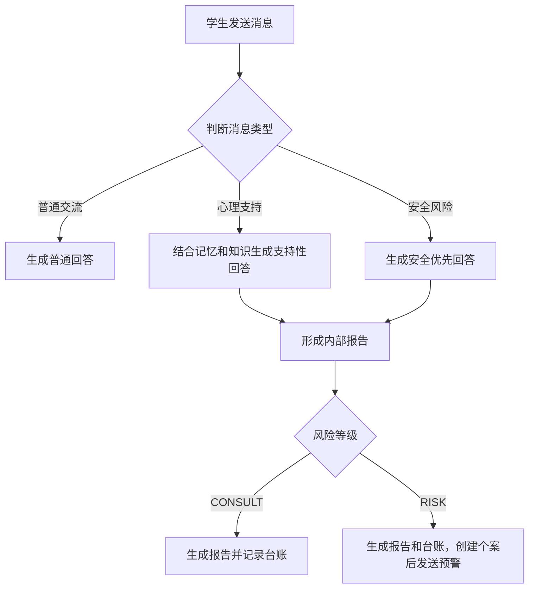

# MindNook 产品需求文档

> 文档版本：1.2  
> 更新日期：2026-07-30

---

## 1. 产品概述

### 1.1 产品定位

MindNook 是一个面向高校学生和校园心理工作者的智能心理关怀平台。

平台为学生提供日常交流、情绪支持和安全求助引导；对需要关注的心理风险形成内部报告和个案记录，帮助授权工作人员完成跟进。

### 1.2 产品目标

- 为学生提供低门槛、温和、非评判的倾诉空间。
- 区分普通交流、心理支持和安全风险，避免将普通问题心理化。
- 为情绪困扰提供具体、可执行的支持建议。
- 对自伤、自杀、伤人或即时危险信号进行优先处理。
- 帮助工作人员查看报告、跟进个案和维护校园支持资源。

### 1.3 产品边界

MindNook 是辅助支持工具，不替代心理咨询师、医生或紧急救援机构。

平台不得：

- 诊断心理或精神疾病。
- 推荐药物或提供治疗方案。
- 向学生展示后台风险等级、评分和报告信息。
- 提供危险行为的方法、工具或操作细节。
- 编造学校电话、办公时间或当地紧急资源。
- 作出妨碍现实援助的绝对保密承诺。

---

## 2. 用户角色

### 2.1 学生

学生可以：

- 登录个人心理陪伴空间。
- 与智能助手进行多轮对话。
- 咨询压力、睡眠、情绪、人际关系、家庭关系、学业和校园适应等问题。
- 获取普通学习、校园生活和日常问题的帮助。
- 开始新的对话。
- 在风险场景中获得现实求助引导。

学生只能访问自己的信息和对话，不能查看心理报告、风险个案或其他学生的数据。

### 2.2 管理员 / 咨询师

管理员或咨询师可以：

- 查看心理支持报告和风险概况。
- 查看处理个案所需的对话背景。
- 跟进风险个案并添加备注。
- 维护校园心理知识和支持资源。
- 查看预警、失败任务和必要的审计记录。

管理员只能在授权范围内访问学生敏感信息，且不能以管理员身份发起学生陪伴对话。

### 2.3 系统运营人员

系统运营人员负责服务状态、数据安全、异常任务和系统配置。其权限应与心理个案处理权限分离。

---

## 3. 核心业务规则

### 3.1 对话分类

| 类型 | 典型内容 | 系统行为 |
|---|---|---|
| 普通交流 | 学习、编程、作业、校园事务、日常问答 | 直接回答，不进行心理评估 |
| 心理支持 | 压力、焦虑、低落、失眠、关系和适应困扰 | 结合对话背景与知识提供支持，并形成内部报告 |
| 安全风险 | 自伤、自杀、伤人、严重绝望或即时危险 | 优先执行安全响应，并进入人工跟进流程 |

### 3.2 风险等级

| 等级 | 定义 | 后续处理 |
|---|---|---|
| `CHAT` | 普通交流 | 不触发心理 RAG、心理报告或风险工具 |
| `CONSULT` | 存在心理困扰，包括持续影响生活但无明确即时伤害意图 | 生成心理报告和工作台账 |
| `RISK` | 出现明确伤害意图、计划或即时危险 | 创建风险个案，生成报告、台账，并在个案创建成功后触发预警 |

风险等级只供后台和授权工作人员使用，不直接展示给学生。

### 3.3 业务流程

所有后台记录和通知均不得阻塞学生获得回复。

---

## 4. 学生端功能

### 4.1 登录与身份

- 学生使用个人账号登录。
- 登录成功后进入学生服务空间。
- 登录状态失效时需要重新登录。
- 学生可以主动退出。
- 学生不能访问管理功能或他人数据。

### 4.2 心理陪伴对话

- 支持文本和多轮对话。
- 回复生成过程中提供清晰状态，并逐步展示内容。
- 避免重复提交。
- 请求失败时提供错误提示和重试机会。
- 支持开始新会话。
- 新会话不自动删除历史数据。

页面布局和交互形式可根据整体产品设计调整。

### 4.3 快捷表达

平台可以提供常见问题入口，帮助学生开始表达，例如：

- 压力和失眠。
- 考试焦虑。
- 情绪低落。
- 人际或家庭关系。
- 校园适应。

### 4.4 回答要求

普通问题：

- 自然、直接地回答当前问题。
- 不主动进行心理测评。
- 不使用报告或诊断口吻。

心理支持问题：

- 先回应学生的具体感受或处境。
- 保持温和、稳定、非评判。
- 提供一至两个具体、可执行的小步骤。
- 困扰持续、加重或影响生活时，建议联系现实支持。
- 不输出风险等级、评分、置信度或报告信息。

高风险问题：

- 明确回应学生当前的痛苦。
- 将当前安全置于长期分析之前。
- 鼓励学生立即联系身边可信任的人。
- 鼓励不要独处，并前往有人在场的安全环境。
- 建议联系学校心理中心、辅导员、校园安全部门或当地紧急服务。
- 提供未来 10 至 15 分钟内可执行的一个行动。
- 必要时只询问一个与当前安全直接相关的问题。
- 不提供危险方法或细节。

### 4.5 服务边界提示

平台应向学生说明：

- MindNook 是辅助支持工具。
- 平台不能替代专业咨询或医疗服务。
- 出现即时危险时应优先寻求现实中的人员和紧急服务。
- 必要的安全场景可能触发授权工作人员跟进。

---

## 5. 管理端功能

### 5.1 工作概览

管理员应能快速了解：

- 心理支持报告数量。
- 高风险事件数量。
- 待跟进个案数量。
- 预警和异常任务情况。

具体展示形式不作限制。

### 5.2 报告管理

报告包含：

- 学生标识。
- 报告时间。
- 对话类型。
- 情绪概况。
- 风险等级。
- 判断摘要和可靠性信息。
- 与报告相关的学生表达。

管理员可以：

- 按风险等级、学生和时间查询报告。
- 查看报告详情。
- 查看与报告相关的必要会话背景。

### 5.3 风险个案管理

管理员可以：

- 查看待处理和历史风险个案。
- 查看风险摘要和交接信息。
- 确认接手并指定负责人。
- 添加跟进备注。
- 记录后续安排和复访时间。
- 更新、关闭或重新打开个案。

个案状态建议包括：待处理、已通知、已接手、跟进中和已关闭。

所有状态变化和备注应保留操作人及时间。

### 5.4 知识库管理

管理员可以：

- 上传和查看心理支持知识。
- 更新、停用或删除知识来源。
- 查看内容处理状态。
- 维护学校心理中心、辅导员和紧急支持资源。
- 在知识异常时查看原因并恢复服务。

上传内容需要经过格式和安全校验。

### 5.5 运行与异常

授权人员可以查看：

- 预警发送状态。
- 后台任务状态和失败原因。
- 多次重试后仍失败的异常任务。
- 智能判断和安全审查的必要摘要。
- 敏感数据访问和重要操作记录。

---

## 6. 智能支持能力

### 6.1 意图识别

平台应根据当前消息和必要的对话背景，识别普通交流、心理支持或安全风险。

要求：

- 明确危险表达必须优先进入安全流程。
- 普通学习和校园问题不得被强行归为心理咨询。
- 无法确定时应采取谨慎但不过度惊扰学生的策略。
- 识别结果应保留必要理由，供后台复核。

### 6.2 风险评估

心理支持和风险消息应形成内部评估，包括：

- 情绪概况。
- 风险等级。
- 判断可靠性。
- 简短理由。

明确的自伤、自杀、伤人或即时危险表达必须由固定安全规则优先识别，不能完全依赖智能模型，也不能被模型降级。

评估结果只用于辅助人工判断，不构成临床诊断。

### 6.3 智能角色协作

平台可以由多个职责独立的智能角色协作，包括：

- 理解学生意图。
- 判断安全风险。
- 汇总对话背景和校园知识。
- 生成候选回复。
- 审查回复安全性。

高风险回复必须经过安全检查。安全检查不通过时，应修改回复后再发送。处理过程应有明确上限，失败时使用安全回退回复。

### 6.4 回答质量

学生可见回答应：

- 使用自然、易懂的语言。
- 避免生硬的报告口吻和重复免责声明。
- 不贴标签，不作过度推断。
- 建议数量适中，并与当前处境相关。
- 校园资源信息来自经过维护的可靠内容。

---

## 7. 对话记忆与知识库

### 7.1 对话记忆

平台应保留连续对话所需的近期背景，例如学生的主要困扰和已经给过的建议。

要求：

- 长对话可以压缩为内部摘要。
- 摘要不得添加原对话中没有的事实。
- 不将后台风险标签作为学生长期特征。
- 不同学生和会话之间必须隔离。
- 记忆不可用时，基础对话仍应可用。

### 7.2 心理知识库

知识库应覆盖：

- 风险等级和安全边界。
- 焦虑、恐慌、低落和睡眠支持。
- 学业压力和考试焦虑。
- 人际、家庭和校园适应。
- 咨询转介和校园资源。
- 隐私、伦理和服务边界。

要求：

- 内容应来自可信来源或经过专业审核。
- 校园联系方式和服务政策应有更新时间。
- 心理支持场景优先使用相关知识。
- 普通交流不应无意义地检索心理内容。
- 知识不足或不可用时，不得编造学校资源。
- 重要资源信息应能够追溯到来源。

---

## 8. 报告、个案与预警

### 8.1 心理支持报告

心理支持和安全风险对话应形成内部报告，普通交流不生成报告。

报告包含：

- 学生和会话标识。
- 学生本轮表达。
- 对话类型。
- 情绪概况。
- 风险等级。
- 判断可靠性和摘要。
- 创建时间。

报告应标明由智能系统生成，只用于辅助人工跟进，不直接展示给学生。

### 8.2 风险个案

- 中风险和高风险报告创建个案。
- 同一报告不得重复创建个案。
- 个案记录负责人、状态、摘要、交接信息、跟进备注和时间。
- 低风险报告可由管理员根据实际情况人工升级。

交接摘要应简洁、事实化，并说明：

- 风险和情绪概况。
- 学生表达的必要摘录。
- 是否需要确认当前位置、当前安全和是否有人陪伴。
- 建议联系的现实支持。
- 建议的后续行动。

### 8.3 工作台账

心理支持报告应写入工作人员台账，包括报告标识、风险等级、情绪概况、摘要和时间。

同一报告重复处理时不得生成重复成功记录。

### 8.4 高风险预警

高风险预警应发送给已配置的授权接收人，并包含处理所需的最少信息。

要求：

- 预警失败不影响学生获得安全回复。
- 发送失败后自动重试。
- 多次失败后进入人工异常列表。
- 限制重复通知频率。
- 预警渠道和接收人可配置。

---

## 9. 隐私与安全

### 9.1 隐私保护

- 识别并保护手机号、邮箱、证件号、学号和定位等敏感信息。
- 发送给智能模型的内容应优先脱敏。
- 日志和处理记录不默认保存不必要的完整原文。
- 学生数据只对有业务需要的授权人员开放。
- 查看敏感会话、报告和个案需要记录审计。
- 向学生说明数据用途、人工可见范围和高风险跟进机制。

### 9.2 数据管理

平台应明确：

- 数据保存期限。
- 学生数据查询和导出机制。
- 符合政策要求的删除或匿名化机制。
- 个案关闭后的归档规则。
- 备份数据的保护方式。

### 9.3 账号与权限安全

- 密码使用安全的不可逆算法存储。
- 生产环境不得保留公开默认密码。
- 限制连续登录失败。
- 高权限账号采用更严格的验证方式。
- 服务端必须校验权限，不能只依赖页面隐藏。
- 数据导出和高风险操作需要额外确认。

### 9.4 伦理要求

- 不将智能评估作为唯一处分或强制决策依据。
- 高风险事件允许人工复核。
- 风险处置规则应经过学校心理、法律、伦理和信息安全负责人审核。
- 对学生的表达保持尊重，不使用歧视、侮辱或标签化语言。

---

## 10. 非功能需求

### 10.1 可用性

- 学生发送消息后应快速获得处理反馈。
- 回复逐步呈现，避免长时间无反馈。
- 非核心能力故障时，基础对话和高风险安全响应应尽可能可用。
- 高风险事件优先于普通后台任务。
- 管理数据较多时支持分页和条件查询。

### 10.2 可访问性

- 主要功能支持键盘操作。
- 状态不能只通过颜色表达。
- 文字和背景保持足够对比度。
- 适配常见桌面和移动设备。
- 页面视觉和布局可根据品牌设计调整。

### 10.3 可维护性

- 风险规则、校园资源和支持规则可以独立更新。
- 智能模型、知识能力和通知渠道可以替换或扩展。
- 关键业务规则具备自动化测试。
- 重要配置变化保留记录。

---

## 11. 核心验收标准

### 11.1 普通交流

- 学生询问普通问题时，系统自然回答。
- 不进行不必要的心理评估。
- 不生成心理报告、个案或预警。

### 11.2 心理支持

- 系统能够识别压力、焦虑、低落、睡眠和关系困扰。
- 回答先共情，再提供少量具体建议。
- 回答不包含后台风险信息。
- 生成内部心理支持报告。
- 中风险自动创建风险个案，低风险默认不创建。

### 11.3 高风险

- 明确自伤、自杀、伤人或即时危险表达可以被固定安全规则识别。
- 回复优先关注当前安全、现实支持和短期行动。
- 回复不包含危险操作细节。
- 回复经过安全检查。
- 系统生成报告、台账、个案和预警。
- 预警失败不影响学生收到安全回复。

### 11.4 权限与隐私

- 学生无法访问管理功能、他人对话或后台报告。
- 管理员敏感操作能够审计。
- 不同学生之间不会串用对话记忆。
- 常见个人敏感信息在智能处理前得到保护。

### 11.5 知识与个案

- 管理员能够维护校园心理知识和资源。
- 系统不会编造不存在的校园信息。
- 同一报告不会重复创建个案或重复记账。
- 个案状态和备注保留完整历史。
- 多次失败的高风险通知进入人工处理列表。

---

## 12. 待确认事项

1. 学生、咨询师、辅导员和系统管理员的具体角色划分。
2. 是否保留学习、编程和一般校园助手能力。
3. 学校内部的中高风险判定与人工跟进标准。
4. 哪些工作人员可以查看学生原始对话。
5. 学生数据的保存期限、导出和删除政策。
6. 校心理中心、辅导员、校园安全和当地紧急资源信息。
7. 风险通知渠道、接收人和处理时限。
8. 个案接手、转交、关闭和复访流程。
9. 是否需要历史会话、匿名使用或人工转接。
10. 上线前所需的心理、法律、伦理和信息安全审查。
