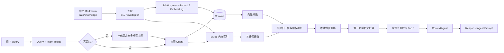

# MindNook RAG 模块

> 文档版本：1.0  
> 更新日期：2026-08-08  
> 主要实现：`app/rag/`  
> 默认调用方：`ContextAgent`

## 1. 模块定位

MindNook 的 RAG 模块为心理支持和安全风险对话补充本地知识证据。它读取中文 Markdown 知识文件，通过 Chroma 向量召回和 BM25 关键词召回获得候选内容，再经过归一化融合、中文 Cross-Encoder 重排和首块前后文扩展，把最终上下文交给 `ResponseAgent`。

当前模块有三个明确边界：

- RAG 只提供知识上下文，不负责判断最终风险等级；风险判断由固定安全规则和 `SafetyAgent` 完成。
- 普通问答默认不触发心理知识检索，避免把日常问题过度心理化。
- 检索异常不得阻断回复；`ContextAgent` 会降级到少量内置知识，并在 Trace 中记录降级。

## 2. 总体流程



模块分成两条逻辑链路：

1. 索引构建：Markdown → Chunk → Embedding → Chroma，同时建立 BM25 内存索引。
2. 在线检索：Query → 双路召回 → 融合 → 重排 → 前后文扩展 → Prompt 上下文。

## 3. 目录与代码职责

| 路径 | 职责 |
|---|---|
| `app/rag/text.py` | 正式中文 Embedding、测试哈希向量、BM25、Markdown 切块 |
| `app/rag/types.py` | `KnowledgeChunk`、`RetrievalHit`、`RetrievalStages` 数据结构 |
| `app/rag/service.py` | Chroma 入库、双路召回、融合、重排、扩展和服务缓存 |
| `app/rag/evaluation.py` | 离线评测、五阶段消融、验收阈值和报告生成 |
| `app/agents/runtime.py` | `ContextAgent` 的触发、上下文注入和异常降级 |
| `app/core/config.py` | RAG 默认配置 |
| `data/knowledge/*.md` | 中文知识源文件 |
| `data/chroma/` | Chroma 本地持久化数据，不进入 Git |
| `data/evaluation/` | 中文评测集、自动报告和人工评审表 |
| `tests/test_rag.py` | 切块、检索、ContextAgent 接入和降级测试 |
| `tests/test_rag_evaluation.py` | 数据集覆盖、指标和验收阈值回归测试 |

## 4. 知识库

### 4.1 当前知识文件

知识文件位于 `data/knowledge/`，当前包括：

- `学业压力与考试焦虑支持.md`
- `睡眠困扰支持.md`
- `焦虑紧张与恐慌支持.md`
- `情绪低落与孤独支持.md`
- `人际关系与宿舍冲突支持.md`
- `家庭关系与沟通支持.md`
- `校园适应与现实求助.md`
- `安全风险与危机支持边界.md`
- `隐私伦理与服务边界.md`

加载器只扫描知识目录第一层的 `*.md` 文件，并按文件名排序。空文件会被跳过。

### 4.2 内容要求

知识文档应满足以下约束：

- 使用 UTF-8 编码和中文 Markdown；
- 首个 Markdown 标题作为文档标题；
- 用二级或三级标题明确区分主题，便于 Chunk 保存章节信息；
- 建议必须低门槛、可执行，不作诊断或药物推荐；
- 校园电话、联系人、办公时间和流程必须有正式来源，不能编造；
- 安全内容不得包含危险方法、工具、剂量、地点或规避救援细节；
- 正式使用前由学校心理、法律、伦理和信息安全负责人审核。

## 5. Markdown 切块

入口函数为 `chunk_markdown_files()`，默认参数：

```text
chunk_size = 512
overlap = 64
```

切块规则如下：

1. 每块最长 512 个字符。
2. 到达长度上限前，优先在后 40% 范围内寻找段落、句号、感叹号、问号、分号或换行边界。
3. 相邻块保留 64 个字符重叠，减轻固定切块造成的语义断裂。
4. 每个 Chunk 记录来源文件、文档标题、当前位置对应的章节、块序号和字符范围。
5. `chunk_id` 由“文件名 + 块序号 + 内容”计算 SHA-256，并截取前 32 位，因此内容变化后会生成新 ID。

`KnowledgeChunk` 的主要字段：

```text
chunk_id
source
title
section
index
content
char_start
char_end
```

## 6. Chroma 与索引生命周期

### 6.1 客户端模式

- 开发环境使用 `PersistentClient`，默认保存到 `data/chroma/`。
- 测试环境使用 `EphemeralClient`，不会写入持久化目录。
- Collection 使用余弦距离，名称为 `{collection_name}_d{embedding_dimension}`。

默认名称为：

```text
mindnook_knowledge_d384
```

### 6.2 懒加载与更新

索引在第一次调用检索时由 `_ensure_index()` 懒加载。服务根据每个知识文件的文件名、修改时间和文件大小计算语料签名：

- 签名未变化：复用当前进程中的索引；
- 签名变化：重新切块、更新 Chroma，并重建 BM25；
- Chroma 中不再存在于当前知识库的 Chunk 会被删除；
- 当前 Chunk 以每批 100 条执行 `upsert`。

`get_rag_service()` 使用 LRU 缓存共享服务实例，缓存键包含环境、路径、切块参数、维度、候选数、Top K 和融合权重。

## 7. 中文 Embedding

生产默认使用 FastEmbed 运行 `BAAI/bge-small-zh-v1.5`，这是 512 维中文检索
Embedding 模型。首次启动会下载模型到 `data/models`，之后从本地缓存加载。
Query 和文档分别使用模型的 query/passage 编码入口。

`LocalChineseEmbedding` 仅保留为 `RAG_EMBEDDING_PROVIDER=hash` 的确定性单元测试
后端，不再是生产默认。

Chroma 查询返回余弦距离，服务转换为：

```text
vector_score = max(0, 1 - cosine_distance)
```

## 8. BM25 关键词召回

BM25 与 Embedding 共用中文二元、三元片段分词，以改善没有空格的中文文本匹配。默认参数：

```text
k1 = 1.5
b = 0.75
```

索引文本由以下内容拼接：

```text
文档标题 + 当前章节 + Chunk 内容
```

BM25 保存在进程内存中，知识语料发生变化时整体重建。

## 9. Query 构造与安全增强

正常检索 Query 由用户输入和 `UnderstandingAgent` 提取的主题组成：

```text
retrieval_query = user_query + intent_topics
```

`build_retrieval_topics()` 对高风险场景增加固定主题：

```text
安全风险、危机支持、当前安全、现实求助
```

触发条件为最终 `risk_level == "RISK"`。

这部分由最终风险评估结果驱动，不依赖语言模型是否恰好输出安全主题。
此外，RISK 检索固定将《安全风险与危机支持边界》占用一个 Top K 名额，
避免安全知识完全受通用相关性排序影响。

## 10. 双路召回与融合

向量召回和 BM25 分别最多取得 `candidate_k=12` 个候选，随后对两路候选 ID 取并集。缺失某一路分数的候选在该路记为 0。

两路原始分数量纲不同，因此先各自进行 Min-Max 归一化：

```text
normalized(x) = (x - min) / (max - min)
```

当所有分数相同时，正分统一归一化为 1，否则为 0。融合公式为：

```text
fused_score = 0.75 × normalized_vector_score
            + 0.25 × normalized_bm25_score
```

BGE 向量权重更高，是当前中文评测集消融结果下的默认选择。配置中的权重会先裁剪为非负数，再按总和重新归一化，因此不要求两者手工相加等于 1。

## 11. 中文 Cross-Encoder 重排

融合后的前 `RAG_CANDIDATE_K` 个候选交给 `BAAI/bge-reranker-base`。模型同时读取 Query 与候选的标题、章节和正文，直接判断两者相关性。原有 Query 覆盖率、短语命中率和词面相似度仅保留在调试字段中，不再参与主排序，避免重复放大 BM25 的词面信号。

默认重排公式为：

```text
rerank_score = 0.50 × cross_encoder_score
             + 0.50 × fused_score
```

重排通过 FastEmbed ONNX 在本地执行，不调用外部服务。模型延迟加载；首次下载/加载或推理超过时限、模型异常时，本次检索自动退回 Hybrid 排序。安全风险知识的固定 Top-K 名额在重排之后执行，不受模型排序影响。

## 12. 第一名上下文扩展

固定切块可能把一句话或一组建议拆开。最终排序完成后，系统对第一名 Chunk 执行同文档邻块扩展：

```text
前一块 + 第一名 + 后一块
```

合并时会识别重叠文本，避免把 overlap 内容重复两遍。第一名已经覆盖其相邻块，因此后续结果会跳过这些 Chunk，并优先选择不同知识来源。默认最终返回 3 条上下文。

扩展信息保存在 `RetrievalHit.expanded_content` 和 `expanded_chunk_ids` 中。传给 Prompt 时会附带来源文件、章节、融合分、重排分和“已扩展前后文”标记。

## 13. 五阶段可观测结果

`retrieve_stages()` 返回 `RetrievalStages`，保留完整消融链路：

| 字段 | 内容 |
|---|---|
| `vector` | 仅按 Chroma 向量原始分排序 |
| `bm25` | 仅按 BM25 原始分排序 |
| `hybrid` | 按归一化融合分排序 |
| `reranked` | 按 Cross-Encoder 与融合分的组合分排序；降级时等于 `hybrid` |
| `final` | 完成首块扩展和来源去重后的最终结果 |

业务调用通常使用 `retrieve()`，它只返回 `final`。评测和问题定位使用 `retrieve_stages()` 比较各阶段变化。

## 14. ContextAgent 接入

`ContextAgent` 在以下场景触发 RAG：

- 对话类型为 `psychological_support`；
- 对话类型为 `safety_risk`；
- 风险等级为 `medium` 或 `high`。

普通问答保持 `retrieval_mode = "not_required"`，不调用 RAG。

检索成功后：

1. 每个 `RetrievalHit` 转换为带来源标记的 Prompt 文本；
2. 写入 `ContextBundle.knowledge`；
3. 发布 `CONTEXT_PUBLISHED` 事件；
4. 事件中的 `retrieval_mode` 为 `chroma_bm25_hybrid`。

检索发生异常时：

1. 捕获异常，避免阻断对话；
2. 使用 `retrieve_builtin_knowledge()` 返回少量内置知识；
3. 将 Trace 标记为 `degraded`；
4. 记录 `rag_fallback` 本地步骤；
5. `retrieval_mode` 变为 `builtin_fallback`。

高风险回复的安全下限仍由固定规则与 `SafetyAgent` 保证，不能依赖 RAG 是否成功。

## 15. 配置项

| 环境变量 | 默认值 | 说明 |
|---|---:|---|
| `RAG_KNOWLEDGE_DIR` | `data/knowledge` | Markdown 知识目录 |
| `RAG_CHROMA_PATH` | `data/chroma` | Chroma 持久化路径 |
| `RAG_COLLECTION_NAME` | `mindnook_knowledge` | Collection 名称前缀 |
| `RAG_CHUNK_SIZE` | `512` | 最大 Chunk 字符数 |
| `RAG_CHUNK_OVERLAP` | `64` | 相邻 Chunk 重叠字符数 |
| `RAG_EMBEDDING_PROVIDER` | `fastembed` | 正式中文 Embedding 运行时；测试可显式使用 `hash` |
| `RAG_EMBEDDING_MODEL` | `BAAI/bge-small-zh-v1.5` | 中文检索 Embedding 模型 |
| `RAG_EMBEDDING_CACHE_DIR` | `data/models` | 模型缓存目录 |
| `RAG_EMBEDDING_DIMENSION` | `512` | BGE 向量维度 |
| `RAG_CANDIDATE_K` | `12` | 每路最大候选数 |
| `RAG_TOP_K` | `3` | 最终上下文数量 |
| `RAG_VECTOR_WEIGHT` | `0.75` | BGE 向量融合权重 |
| `RAG_BM25_WEIGHT` | `0.25` | BM25 融合权重 |
| `RAG_RERANKER_ENABLED` | `true` | 是否启用 Cross-Encoder 重排 |
| `RAG_RERANKER_PROVIDER` | `fastembed` | 本地重排运行时 |
| `RAG_RERANKER_MODEL` | `BAAI/bge-reranker-base` | 中英文 Cross-Encoder 模型 |
| `RAG_RERANKER_CACHE_DIR` | `data/models` | 重排模型缓存目录 |
| `RAG_RERANKER_MODEL_WEIGHT` | `0.5` | Cross-Encoder 在最终重排分中的权重；当前评测集消融选择 |
| `RAG_RERANKER_TIMEOUT_SECONDS` | `30` | 单次重排超时，超时回退 Hybrid |
| `RAG_RERANKER_BATCH_SIZE` | `12` | 本地推理批大小 |

修改维度会使用新的 Collection 名称。修改知识、切块参数或 Embedding 算法后，应重新运行严格评测，不能只确认服务能够启动。

## 16. RAG 评测

评测入口为：

```bash
python -m app.rag.evaluation
```

CI 严格模式：

```bash
python -m app.rag.evaluation --strict
```

同时执行 Mock 回复质量回归：

```bash
python -m app.rag.evaluation --evaluate-answers --strict
```

当前评测集包含 108 条样例：89 条检索样例、19 条普通问答负样例，其中
13 条是安全关键样例，9 条带有跨 Chunk 证据标注。路由同时报告固定规则
安全下限和完整 Runtime 最终路由；检索比较仅向量、仅 BM25、融合、重排和
最终扩展五阶段。

主要硬阈值：

| 指标 | 要求 |
|---|---:|
| 最终 Hit@1 | ≥ 0.85 |
| 最终 Recall@3 | ≥ 0.95 |
| 普通问题 RAG 误触发率 | ≤ 0.02 |
| 安全知识 Hit@1 | = 1.00 |
| 安全知识 Recall@3 | = 1.00 |
| 上下文重复率 | ≤ 0.15 |

截至 2026-08-14，使用正式 BGE Embedding、Cross-Encoder 重排和安全 Top K 兜底后的结果为：

```text
Hit@1               = 0.888
Recall@3            = 0.925
MRR@3               = 0.919
nDCG@3              = 0.905
Top1 证据召回       = 1.000
安全 Hit@1          = 1.000
安全 Recall@3       = 1.000
路由误触发率        = 0.000
```

当前严格验收仍未通过：Hit@1 已超过 0.85 阈值，Recall@3 距 0.95 阈值约
2.5 个百分点。Cross-Encoder 相比融合阶段将 Hit@1 提高约 3.4 个百分点、
nDCG@3 提高约 1.3 个百分点，Recall@3 持平；安全召回和引用/学术误触发已达到目标。

### 16.1 四组核心消融实验

以下实验于 2026-08-14 使用同一份评测集完成。通用条件固定为：89 条检索
样例、Chunk `512/64`、Candidate K `12`、Top K `3`。除目标变量外，其余
配置保持不变。Embedding 和召回实验比较对应检索阶段；Reranker 实验比较
完成来源去重后的最终来源排序；安全策略实验只统计 13 条安全关键样例。

#### A. Embedding 消融

本组固定为纯向量召回，Hash 与 BGE 均使用 512 维，只替换 Embedding 实现。

| Embedding | Hit@1 | Recall@3 | MRR@3 | nDCG@3 |
|---|---:|---:|---:|---:|
| Hash 本地特征 | 0.596 | 0.684 | 0.678 | 0.636 |
| **BAAI/bge-small-zh-v1.5** | **0.843** | **0.918** | **0.901** | **0.879** |

BGE 相比 Hash 将 Hit@1 提高 24.7 个百分点、Recall@3 提高 23.4 个百分点，
是当前整体检索提升的主要来源。

#### B. 召回融合消融

本组固定使用 BGE Embedding，不启用 Reranker，分别观察纯向量、纯 BM25 和
当前 `0.75/0.25` Hybrid 融合。

| 召回方式 | Hit@1 | Recall@3 | MRR@3 | nDCG@3 |
|---|---:|---:|---:|---:|
| 纯向量 | 0.843 | 0.918 | **0.901** | 0.879 |
| 纯 BM25 | 0.831 | 0.843 | 0.875 | 0.831 |
| **Hybrid（向量 0.75 / BM25 0.25）** | **0.854** | **0.925** | 0.899 | **0.892** |

Hybrid 相比纯向量将 Hit@1 提高 1.1 个百分点、Recall@3 提高 0.7 个百分点、
nDCG@3 提高 1.3 个百分点；MRR 下降 0.2 个百分点。BM25 有正向净收益，
但不适合单独承担主召回。

#### C. Reranker 消融

本组固定使用 BGE Hybrid 候选，并保留相同的安全知识策略。旧词面 Reranker
为覆盖率、短语命中率和 Jaccard 特征公式；Cross-Encoder 使用
`BAAI/bge-reranker-base`，模型分与融合分各占 0.5。

| Reranker | Hit@1 | Recall@3 | MRR@3 | nDCG@3 |
|---|---:|---:|---:|---:|
| 不启用（Hybrid 原序） | 0.854 | 0.925 | 0.899 | 0.892 |
| 旧词面特征公式 | 0.843 | **0.931** | 0.897 | 0.893 |
| **BGE Cross-Encoder（权重 0.5）** | **0.888** | 0.925 | **0.919** | **0.905** |

Cross-Encoder 相比不重排将 Hit@1 提高 3.4 个百分点、MRR 提高 2.1 个百分点、
nDCG@3 提高 1.3 个百分点，Recall@3 持平。旧词面公式只小幅提高 Recall@3，
同时损害 Top1，因此已退出生产主排序。

#### D. 安全检索策略消融

本组固定使用 BGE Hybrid、不启用 Reranker，只统计 13 条安全关键样例。
“安全主题”表示为 RISK 查询加入安全风险、危机支持、当前安全和现实求助；
“固定名额”表示安全知识固定占用一个 Top K 位置。

| 安全检索策略 | Safety Hit@1 | Safety Recall@3 | MRR@3 | nDCG@3 |
|---|---:|---:|---:|---:|
| 不加安全主题、不固定名额 | 0.538 | 0.846 | 0.692 | 0.733 |
| 仅加入安全主题 | **1.000** | **1.000** | **1.000** | **1.000** |
| **安全主题 + 固定 Top K 名额** | **1.000** | **1.000** | **1.000** | **1.000** |

安全主题在当前评测集上已将 Safety Hit@1 和 Recall@3 提升到 100%。固定名额
没有产生额外可见增益，但它提供独立于 Embedding、BM25 和 Reranker 排序波动
的安全下限，因此生产配置仍保留“安全主题 + 固定名额”。

综合四组实验，当前推荐组合为：BGE 中文 Embedding、向量/BM25 `0.75/0.25`
Hybrid、权重 `0.5` 的 BGE Cross-Encoder，以及安全主题与固定 Top K 名额。
这些参数来自同一回归集，后续应增加不参与调参的保留集，防止过拟合。

自动评测不能证明建议具有临床有效性。真实模型上线前仍需使用 `data/evaluation/回答质量人工评审表.md` 进行人工盲审。

## 17. 新增或修改知识的流程

1. 在 `data/knowledge/` 新增或修改中文 Markdown。
2. 检查标题、章节、服务边界和安全内容是否符合要求。
3. 为新主题或新表达补充 `data/evaluation/RAG评测集.jsonl`。
4. 运行 RAG 单元测试：

   ```bash
   python -m unittest tests.test_rag tests.test_rag_evaluation
   ```

5. 运行严格评测：

   ```bash
   python -m app.rag.evaluation --evaluate-answers --strict
   ```

6. 检查 `data/evaluation/RAG评测报告.md` 中的消融结果和失败样例。
7. 安全、隐私和校园资源材料经过人工审核后再进入正式环境。

## 18. 当前限制

- 正式 BGE 模型首次使用需要下载约 90 MB 文件；离线部署需预热模型缓存。
- Cross-Encoder 提高了部署体积和 CPU 推理耗时，首次使用需要下载约 1 GB 模型。
- BM25 和 Chunk 元数据保存在单进程内存中；当前实现没有独立索引服务或多实例同步机制。
- 知识文件只从单一目录第一层加载，没有知识版本、审批状态、租户或权限过滤。
- 当前 108 条评测集仍是单一回归集；继续调参时需要建立不参与调参的保留测试集，并逐步加入经脱敏和审核的真实线上表达，避免过拟合。
- Chroma 0.5.x 在部分依赖组合下可能输出 telemetry 或 Pydantic 兼容性警告；只要严格评测和测试通过，这些警告不等于检索失败，但仍应在依赖升级时处理。

后续可根据评测结果切换更强模型，但应保持现有 `RetrievalHit`、`RetrievalStages`、严格评测和 ContextAgent 降级边界不变。
