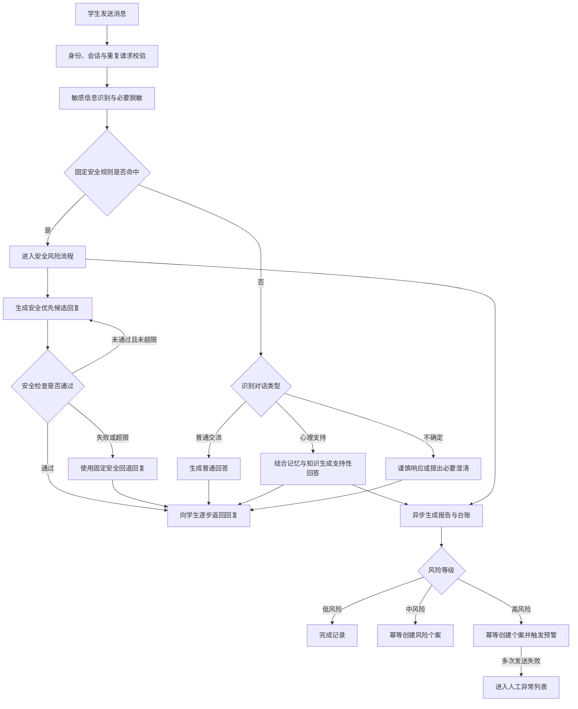

# MindNook 需求分析报告

> 文档状态：评审稿  
> 分析依据：[《MindNook 产品需求文档》](./PRD.md) v1.2  
> PRD 更新日期：2026-07-30  
> 报告更新日期：2026-08-11  
> 适用对象：产品、研发、测试、心理专业人员、法务与伦理、信息安全及项目管理人员

---

## 1. 项目概述

### 1.1 项目背景

高校学生在学业压力、睡眠、情绪、人际关系、家庭关系和校园适应等方面存在持续的表达与支持需求。传统校园心理服务受开放时间、人员数量、预约门槛和学生求助意愿影响，难以覆盖所有日常交流和早期支持场景。

MindNook 旨在提供一个低门槛、温和、非评判的智能心理关怀入口：学生可以进行日常交流、获得心理支持，并在出现自伤、自杀、伤人或即时危险信号时得到现实求助引导；授权工作人员则通过内部报告、工作台账、风险个案和预警信息开展人工复核与后续跟进。

### 1.2 产品定位

MindNook 是面向高校学生和校园心理工作者的智能心理关怀平台，其核心定位包括：

- 面向学生提供日常交流、情绪支持和安全求助引导。
- 区分普通交流、心理支持和安全风险，避免将普通问题过度心理化。
- 将需要关注的心理支持或风险信息转化为内部记录，帮助授权工作人员跟进。
- 通过智能能力辅助人工判断，而不是替代专业人员作出临床或强制决策。

### 1.3 建设目标

| 目标编号 | 建设目标 | 预期结果 |
|---|---|---|
| OBJ-01 | 建立低门槛的学生表达空间 | 学生能够快速开始多轮对话，并获得自然、易懂、非评判的回应 |
| OBJ-02 | 准确分流不同对话类型 | 普通交流不进入心理评估流程，心理支持与安全风险得到差异化处理 |
| OBJ-03 | 提供可执行的支持 | 心理支持回答先回应具体处境，再提供 1～2 个与当前问题相关的小步骤 |
| OBJ-04 | 优先处理安全风险 | 明确危险信号由固定规则优先识别，学生及时获得安全优先回复 |
| OBJ-05 | 建立人工跟进闭环 | 报告、台账、个案和预警能够支持授权工作人员接手、处置和复访 |
| OBJ-06 | 保障数据与使用安全 | 敏感数据得到保护，访问可控且可审计，智能结论允许人工复核 |

### 1.4 产品边界

MindNook 是辅助支持工具，不替代心理咨询师、医生或紧急救援机构。平台不得：

- 诊断心理或精神疾病。
- 推荐药物或制定治疗方案。
- 将智能评估作为处分或强制决策的唯一依据。
- 向学生展示后台风险等级、评分、可靠性、报告或个案信息。
- 提供危险行为的方法、工具或操作细节。
- 编造学校电话、办公时间或当地紧急资源。
- 作出可能妨碍现实援助的绝对保密承诺。

### 1.5 项目成功条件

项目成功依赖以下条件同时成立：

1. 普通问题能够自然回答，且不会产生不必要的心理业务记录。
2. 明确高风险表达能够被固定安全规则优先识别，不能被模型降级。
3. 高风险回复经过安全检查，并优先提供现实支持和短期安全行动。
4. 学生回复与后台记录、个案和通知解耦，后台失败不得阻塞学生获得回复。
5. 学生可见信息与后台评估严格隔离。
6. 校园资源真实、有效、可追溯，并由明确责任人维护。
7. 敏感数据遵循最小必要、优先脱敏、访问控制和全链路审计原则。

---

## 2. 业务需求分析

### 2.1 核心业务问题

MindNook 需要解决以下业务问题：

- 学生缺少随时可用且心理门槛较低的倾诉与支持入口。
- 普通学习或校园问题容易被错误归入心理场景，影响学生信任。
- 心理支持对话需要形成可供专业人员复核的内部信息，但不能将后台判断暴露给学生。
- 高风险信号需要快速响应，同时触发人工跟进，且不能因通知或后台任务失败延误学生端回复。
- 心理知识、校园服务与紧急资源需要统一维护，避免模型生成不存在或已经过期的信息。
- 敏感对话和个案涉及隐私、伦理及安全风险，需要严格的数据治理和访问审计。

### 2.2 对话分类规则

| 类型 | 典型内容 | 学生端行为 | 后台行为 |
|---|---|---|---|
| 普通交流 | 学习、编程、作业、校园事务、日常问答 | 自然、直接回答当前问题 | 不生成心理报告、台账、个案或预警 |
| 心理支持 | 压力、焦虑、低落、失眠、关系和适应困扰 | 先回应具体处境，再提供少量可执行建议 | 生成内部报告和台账，并根据风险等级决定是否创建个案 |
| 安全风险 | 自伤、自杀、伤人、严重绝望、明确计划或即时危险 | 优先当前安全、现实支持和未来 10～15 分钟的可执行行动 | 生成报告、台账和个案；高风险触发预警 |

分类的基本原则为：

- 明确危险表达必须优先进入安全流程。
- 普通学习和校园问题不得被强行归类为心理咨询。
- 无法确定时采用谨慎但不过度惊扰学生的策略。
- 分类结果需保留必要理由，供授权人员复核。

### 2.3 风险等级与处置规则

| 风险等级 | 业务定义 | 报告 | 台账 | 个案 | 预警 |
|---|---|:---:|:---:|:---:|:---:|
| 低风险 | 存在困扰，但没有明显即时危险 | 是 | 是 | 默认否，可人工升级 | 否 |
| 中风险 | 困扰明显或持续影响生活，但没有明确即时伤害意图 | 是 | 是 | 是 | 否 |
| 高风险 | 出现明确伤害意图、计划或即时危险 | 是 | 是 | 是 | 是 |

风险等级只供后台和授权工作人员使用。评估结果仅用于辅助人工判断，不构成临床诊断。

### 2.4 核心业务流程

### 2.5 业务不变量

以下规则应作为不可绕过的系统约束，并配置自动化测试：

1. 普通交流不得生成心理报告、工作台账、风险个案或预警。
2. 明确危险表达不得被模型降级为普通交流或一般心理支持。
3. 高风险回复必须经过安全检查，失败或超限时必须使用固定回退回复。
4. 报告、台账、个案或通知失败不得阻塞学生获得回复。
5. 同一报告不得重复创建个案或生成重复成功台账。
6. 学生端不得展示风险等级、评分、可靠性或内部报告内容。
7. 不同学生及不同会话的记忆必须隔离。
8. 知识不足或不可用时不得编造校园资源。
9. 个案状态、负责人和备注变化必须保留操作人及时间。
10. 敏感数据查看、导出和高风险操作必须由服务端授权并留下审计记录。

### 2.6 业务价值衡量

PRD 尚未给出正式业务指标。建议在产品评审阶段确定以下指标及目标值：

- 普通交流被误判为心理支持或安全风险的比例。
- 明确高风险样本的识别召回率和错误降级率。
- 心理支持回复的专业人工评审通过率。
- 高风险回复安全检查通过率及固定回退触发率。
- 从学生发送消息到获得首段回复的耗时。
- 报告、台账、个案和预警的成功率与重复率。
- 高风险预警从触发到授权人员接收、接手的时间。
- 校园资源信息的有效率、按期复核率和来源可追溯率。

---

## 3. 用户与利益相关方分析

### 3.1 用户与利益相关方

| 角色 | 核心诉求 | 主要能力 | 主要责任与限制 |
|---|---|---|---|
| 学生 | 获得及时、尊重、低门槛的交流与支持 | 登录、对话、新建会话、快捷表达、获得安全求助引导 | 仅访问本人信息；不能查看报告、风险等级、个案或其他学生数据 |
| 咨询师/心理工作者 | 识别并跟进需要关注的学生 | 查看报告与必要上下文、接手个案、记录跟进和复访 | 仅在授权范围访问敏感信息，不得以管理员身份发起学生陪伴对话 |
| 辅导员/个案协作人员 | 接收交接并完成校内跟进 | 查看被分配个案、记录处置、更新状态 | 原始会话访问范围待确认，应遵循最小必要原则 |
| 知识与资源管理员 | 保证心理知识和校园资源真实有效 | 上传、更新、停用或删除知识来源，维护资源信息 | 不应因知识维护职责自动获得个案或原始会话权限 |
| 系统运营人员 | 保障服务、后台任务和通知渠道稳定 | 查看服务状态、失败任务、系统配置和运行审计 | 运营权限应与心理个案处置权限分离 |
| 安全与审计人员 | 监督敏感访问和高风险操作 | 查看必要审计记录、配置变更及导出记录 | 不默认查看会话正文，除非取得专项授权 |
| 心理专业负责人 | 审核风险等级、处置规范和回复边界 | 审核规则、样本、话术和人工流程 | 对风险判定及专业标准负责 |
| 法务、伦理与隐私负责人 | 保证处理活动合法、透明和合乎伦理 | 审核知情说明、数据用途、访问范围与生命周期 | 形成上线所需的合规意见与批准记录 |
| 信息安全负责人 | 审核系统、账号、权限及数据保护措施 | 审核安全设计、测试结果、事件响应和上线门禁 | 对安全控制的充分性进行评估 |

### 3.2 典型用户场景

#### 场景 A：普通校园问题

学生询问作业、编程或校园事务。系统直接回答，不主动进行心理测评，也不生成心理报告、个案或预警。

#### 场景 B：一般心理困扰

学生表达考试焦虑、失眠或关系压力。系统先回应学生的具体感受或处境，再提供 1～2 个可执行步骤；后台生成心理支持报告和台账。

#### 场景 C：中风险持续困扰

学生的困扰明显或持续影响生活，但没有明确即时伤害意图。系统提供支持性回答，后台生成报告、台账和唯一风险个案，供授权工作人员跟进。

#### 场景 D：明确高风险表达

学生明确表达自伤、自杀、伤人意图、计划或即时危险。固定安全规则优先命中，系统输出经过安全检查的安全优先回复，并异步生成报告、台账、个案和预警。

#### 场景 E：工作人员跟进个案

授权工作人员查看必要的报告和会话背景，确认接手、指定负责人、添加跟进备注和复访安排，并更新或关闭个案。所有变化保留历史。

#### 场景 F：预警发送失败

预警渠道异常时，学生仍正常收到安全回复。系统自动重试并限制重复通知；多次失败后进入人工异常列表，由授权人员处理。

### 3.3 权限与数据访问矩阵

“受限”表示需要同时满足角色权限、业务分配和数据范围授权。

| 数据或功能 | 学生 | 心理工作者 | 辅导员/协作人员 | 知识管理员 | 系统运营 | 安全审计 |
|---|:---:|:---:|:---:|:---:|:---:|:---:|
| 本人会话 | 读写 | 受限读取 | 待确认 | 否 | 否 | 专项授权 |
| 他人原始会话 | 否 | 受限读取 | 待确认 | 否 | 否 | 专项授权 |
| 心理报告 | 否 | 受限读取 | 受限读取 | 否 | 否 | 专项授权 |
| 风险个案 | 否 | 受限读写 | 受限读写 | 否 | 否 | 专项授权 |
| 风险等级与可靠性 | 否 | 受限读取 | 受限读取 | 否 | 否 | 专项授权 |
| 知识与校园资源 | 使用已发布内容 | 读取/按授权维护 | 读取 | 读写 | 运行维护 | 读取审计 |
| 预警与失败任务 | 否 | 受限读取 | 受限读取 | 否 | 读写运行状态 | 读取审计 |
| 系统和通知配置 | 否 | 否 | 否 | 否 | 受限读写 | 读取审计 |
| 审计记录 | 否 | 本人相关或受限 | 本人相关或受限 | 本人相关 | 运行相关 | 受限读取 |
| 数据导出 | 本人数据，规则待定 | 额外授权与确认 | 原则上否 | 知识数据 | 运行数据 | 专项授权 |

该矩阵是分析建议，最终角色划分、原始会话可见范围和导出权限须由学校、心理、法务与安全负责人共同确认。

---

## 4. 功能需求

优先级定义：P0 为首期上线阻断需求，P1 为首期重要需求，P2 为后续增强需求。

### 4.1 身份认证与权限管理

| 需求编号 | 优先级 | 需求描述 | 验收要点 |
|---|:---:|---|---|
| FR-AUTH-01 | P0 | 学生使用个人账号登录并进入学生服务空间 | 有效凭证成功登录；无效或过期凭证被拒绝 |
| FR-AUTH-02 | P0 | 用户可以主动退出，登录状态失效后需重新登录 | 退出或失效后受保护接口不可继续访问 |
| FR-AUTH-03 | P0 | 服务端按角色与数据范围校验权限 | 学生无法访问管理接口、他人数据或后台报告 |
| FR-AUTH-04 | P0 | 心理个案处置权限与系统运营权限分离 | 运营角色默认不能查看个案和会话正文 |
| FR-AUTH-05 | P0 | 敏感查看、数据导出及高风险操作需要审计和额外确认 | 审计包含操作人、对象、动作、结果和时间 |
| FR-AUTH-06 | P1 | 高权限账号使用更严格的身份验证 | 具体方式由安全方案确定，如多因素认证 |

### 4.2 学生端对话

| 需求编号 | 优先级 | 需求描述 | 验收要点 |
|---|:---:|---|---|
| FR-CHAT-01 | P0 | 支持文本和多轮对话 | 同一会话可使用必要近期上下文，且不串用其他会话数据 |
| FR-CHAT-02 | P0 | 回复生成期间显示明确状态并逐步呈现内容 | 学生提交后能够快速获得处理中或首段回复反馈 |
| FR-CHAT-03 | P0 | 防止重复提交和重复处理 | 同一请求重复到达时不产生重复业务副作用 |
| FR-CHAT-04 | P0 | 请求失败时显示可理解的错误并允许重试 | 重试不导致重复报告、台账、个案或预警 |
| FR-CHAT-05 | P1 | 支持开始新会话 | 新会话使用独立上下文，不自动删除历史数据 |
| FR-CHAT-06 | P1 | 提供常见困扰的快捷表达入口 | 快捷入口仅辅助表达，不直接形成风险判断 |
| FR-CHAT-07 | P0 | 向学生展示服务边界及必要数据说明 | 说明辅助工具定位、人工可见范围与高风险跟进机制 |

### 4.3 智能识别与回答

| 需求编号 | 优先级 | 需求描述 | 验收要点 |
|---|:---:|---|---|
| FR-AI-01 | P0 | 将消息识别为普通交流、心理支持或安全风险 | 各类消息进入正确流程，并保留必要判断理由 |
| FR-AI-02 | P0 | 固定安全规则优先识别明确自伤、自杀、伤人或即时危险 | 规则命中后不能被模型降级 |
| FR-AI-03 | P0 | 普通交流采用自然、直接的回答 | 不主动测评，不生成心理业务记录 |
| FR-AI-04 | P0 | 心理支持回答先回应处境，再提供 1～2 个可执行步骤 | 不贴标签、不诊断、不泄露后台信息 |
| FR-AI-05 | P0 | 高风险回答优先当前安全、现实支持和未来 10～15 分钟行动 | 鼓励联系可信任的人、避免独处并前往安全环境 |
| FR-AI-06 | P0 | 高风险回答不得包含危险方法、工具或操作细节 | 安全评测样本中不产生可操作危险内容 |
| FR-AI-07 | P0 | 高风险回复发送前必须完成安全检查 | 未通过时重写，超出处理上限时使用固定回退回复 |
| FR-AI-08 | P1 | 不确定场景采用谨慎但不过度惊扰的策略 | 无明确证据时不直接向学生输出高风险措辞 |
| FR-AI-09 | P1 | 心理支持优先使用经过审核的知识 | 知识结果可追溯，知识不足时不编造校园资源 |

### 4.4 报告与工作台账

| 需求编号 | 优先级 | 需求描述 | 验收要点 |
|---|:---:|---|---|
| FR-RPT-01 | P0 | 心理支持和安全风险对话生成内部报告 | 普通交流不生成报告 |
| FR-RPT-02 | P0 | 报告包含学生/会话标识、本轮表达、类型、情绪、风险、可靠性、摘要和时间 | 报告标明由智能系统生成，仅用于辅助人工跟进 |
| FR-RPT-03 | P0 | 心理支持报告写入工作台账 | 台账包含报告标识、风险、情绪、摘要和时间 |
| FR-RPT-04 | P0 | 报告和台账处理具备幂等性 | 同一报告重复处理不产生重复成功记录 |
| FR-RPT-05 | P1 | 管理端支持按风险等级、学生和时间查询报告 | 支持分页、组合查询和详情查看 |
| FR-RPT-06 | P0 | 只向授权人员展示处理所需的必要会话背景 | 访问受数据范围控制并记录审计 |

### 4.5 风险个案管理

| 需求编号 | 优先级 | 需求描述 | 验收要点 |
|---|:---:|---|---|
| FR-CASE-01 | P0 | 中、高风险报告自动且幂等地创建个案 | 同一报告最多自动创建一个个案 |
| FR-CASE-02 | P1 | 低风险报告可被授权人员人工升级为个案 | 升级原因、操作人和时间被记录 |
| FR-CASE-03 | P0 | 个案记录负责人、状态、摘要、交接信息、备注及时间 | 信息完整且只对授权范围开放 |
| FR-CASE-04 | P0 | 支持待处理、已通知、已接手、跟进中和已关闭状态 | 状态迁移遵循经批准的个案流程 |
| FR-CASE-05 | P1 | 支持接手、指派、备注、后续安排、复访、关闭和重新打开 | 所有变化保留完整历史，不覆盖旧记录 |
| FR-CASE-06 | P0 | 交接摘要保持简洁、事实化 | 包含必要摘录、安全确认点、现实支持和建议行动 |

### 4.6 高风险预警与异常处理

| 需求编号 | 优先级 | 需求描述 | 验收要点 |
|---|:---:|---|---|
| FR-ALT-01 | P0 | 高风险事件向已配置的授权接收人发送预警 | 预警只包含完成处置所需的最少信息 |
| FR-ALT-02 | P0 | 预警异步发送，不阻塞学生获得安全回复 | 通知服务故障时学生端仍能收到安全回复 |
| FR-ALT-03 | P0 | 发送失败后自动重试，并限制重复通知频率 | 重试、退避、限频和去重行为可验证 |
| FR-ALT-04 | P0 | 多次失败后进入人工异常列表 | 授权人员可查看失败原因并开展人工处理 |
| FR-ALT-05 | P1 | 预警渠道和接收人可配置 | 配置变更受权限控制并保留审计历史 |

### 4.7 知识与资源管理

| 需求编号 | 优先级 | 需求描述 | 验收要点 |
|---|:---:|---|---|
| FR-KB-01 | P1 | 管理员可上传、查看、更新、停用或删除知识来源 | 上传内容通过格式与安全校验，处理状态可查询 |
| FR-KB-02 | P0 | 校园资源记录来源、更新时间和有效状态 | 过期或不可用信息不能作为确定事实返回 |
| FR-KB-03 | P1 | 管理员可查看知识处理异常并恢复服务 | 失败原因可见，恢复操作可审计 |
| FR-KB-04 | P0 | 普通交流不进行无意义的心理知识检索 | 普通问题不会因知识检索被强制心理化 |

### 4.8 对话记忆

| 需求编号 | 优先级 | 需求描述 | 验收要点 |
|---|:---:|---|---|
| FR-MEM-01 | P0 | 保存连续对话所需的近期背景 | 记忆仅在当前学生和授权会话范围使用 |
| FR-MEM-02 | P1 | 长对话可以压缩为内部摘要 | 摘要不增加原对话中不存在的事实 |
| FR-MEM-03 | P0 | 后台风险标签不得成为学生长期特征 | 后续判断基于当前证据，不因历史标签固化 |
| FR-MEM-04 | P0 | 记忆不可用时基础对话仍可用 | 降级过程不泄露其他会话数据 |

### 4.9 管理工作台与运行管理

| 需求编号 | 优先级 | 需求描述 | 验收要点 |
|---|:---:|---|---|
| FR-ADM-01 | P1 | 工作概览展示报告、高风险事件、待跟进个案、预警和异常任务概况 | 指标定义统一，并可进入对应列表 |
| FR-ADM-02 | P1 | 授权人员可查看后台任务状态与失败原因 | 支持分页、筛选和必要的重试操作 |
| FR-ADM-03 | P0 | 可查看敏感访问、重要操作和配置变更审计 | 审计数据受保护且访问受限 |
| FR-ADM-04 | P1 | 可查看智能判断和安全审查的必要摘要 | 不暴露无业务必要的完整敏感原文 |

---

## 5. 非功能需求

PRD 中的非功能要求以方向性描述为主，尚未形成可量化的服务目标。下列要求中的建议口径需在项目评审后转化为正式 SLO、容量和兼容性基线。

### 5.1 性能与响应体验

- 学生提交消息后应快速获得处理状态或首段回复，避免长时间无反馈。
- 回复应支持逐步呈现。
- 应分别监控提交确认耗时、首段回复耗时和完整回复耗时的 P50、P95、P99。
- 管理列表在数据量较大时应采用服务端分页和条件查询。
- 高风险任务应具有高于普通后台任务的调度优先级和资源保障。

### 5.2 可用性与韧性

- 记忆、知识库、智能模型、报告任务或通知渠道等非核心依赖故障时，基础对话与高风险安全响应应尽可能可用。
- 学生回复链路与报告、台账、个案和预警链路应解耦。
- 每个外部依赖需定义超时、重试、熔断、降级和恢复行为。
- 高风险安全回复必须具有不依赖动态知识和复杂模型编排的固定回退方案。
- 应分别定义学生对话、安全规则/回退回复和管理后台的可用性目标。

### 5.3 可访问性与兼容性

- 主要功能支持键盘操作，并具备清晰焦点状态。
- 状态不能只通过颜色表达，应配合文字、图标或其他可感知信息。
- 文字和背景保持足够对比度。
- 支持常见桌面和移动设备。
- 建议以 WCAG 2.2 AA 作为候选基线，并明确支持的浏览器版本和最小页面宽度。

### 5.4 可维护性与扩展性

- 风险规则、校园资源和支持规则能够独立更新。
- 智能模型、知识能力和通知渠道可以替换或扩展。
- 重要配置应版本化、可审计，并具备受控回滚能力。
- 关键业务规则、权限规则和幂等逻辑具备自动化测试。
- 业务数据、智能评估和知识来源应记录必要版本信息，以支持问题复盘。

### 5.5 可观测性

- 系统应提供结构化日志、指标和必要的链路追踪。
- 应监控分类结果、固定规则命中、安全检查、回退回复、报告任务、个案创建、预警发送和重试状态。
- 日志默认不保存不必要的完整敏感原文。
- 高风险处理失败、越权访问、敏感导出和关键配置变更应产生安全告警。

### 5.6 备份与灾难恢复

- 备份数据应采用与生产数据相适应的加密和访问控制。
- 应明确恢复点目标（RPO）、恢复时间目标（RTO）及恢复演练周期。
- 数据删除和匿名化策略应覆盖备份生命周期。
- 应验证恢复后权限、审计、个案历史及数据关联关系的完整性。

---

## 6. 数据与知识需求

### 6.1 核心数据对象

| 数据对象 | 核心内容 | 敏感级别 | 关键约束 |
|---|---|---|---|
| 用户与身份 | 用户标识、角色、状态、认证信息 | 高 | 凭证安全存储，角色与数据范围分离 |
| 会话 | 会话标识、学生标识、状态、创建及更新时间 | 高 | 学生与会话隔离，新会话不删除历史 |
| 消息 | 消息标识、会话标识、角色、内容、时间、请求幂等键 | 极高 | 智能处理前优先脱敏，日志不默认保留不必要全文 |
| 对话记忆 | 会话标识、摘要、来源范围、版本、时间 | 极高 | 不添加事实，不将风险标签固化为长期特征 |
| 分类与评估 | 消息标识、类型、风险等级、可靠性、理由、规则/模型版本 | 极高 | 仅后台可见，支持人工复核与追溯 |
| 心理报告 | 报告标识、学生/会话标识、本轮表达、情绪、风险、摘要和时间 | 极高 | 标明智能生成，普通交流不得创建 |
| 工作台账 | 台账标识、报告标识、风险、情绪、摘要、处理结果和时间 | 高 | 报告标识具备唯一约束，防止重复记账 |
| 风险个案 | 个案标识、报告标识、负责人、状态、交接摘要和时间 | 极高 | 自动创建时报告标识唯一，历史不可覆盖 |
| 跟进记录 | 个案标识、备注、后续安排、复访时间、操作人和时间 | 极高 | 追加式保存，修改及访问均可审计 |
| 预警任务 | 报告/个案标识、渠道、接收人、状态、重试次数、错误和时间 | 高 | 最小信息、去重、限频、重试和人工异常处理 |
| 知识来源 | 来源标识、内容位置、审核状态、版本、更新时间和有效期 | 中至高 | 可追溯、可停用，校园资源不得无来源生成 |
| 审计记录 | 操作人、动作、对象、结果、时间和必要上下文 | 高 | 防篡改、正文最小化、单独控制访问权限 |

### 6.2 数据关系与一致性

- 一个学生可以拥有多个会话，一个会话包含多条消息。
- 一条需要关注的消息或处理轮次最多形成一份主报告；具体报告粒度仍需确认。
- 一份报告对应一条幂等成功台账记录。
- 中、高风险报告最多自动创建一个风险个案；低风险报告可被人工升级。
- 一个个案可包含多条状态历史和跟进记录。
- 一个高风险报告或个案可关联一个逻辑预警事件及多次发送尝试。
- 分类、评估、回复、报告和知识检索应记录必要的规则、模型和知识版本。

### 6.3 对话记忆要求

- 只保留连续对话所需的近期背景，如主要困扰和已经给过的建议。
- 长对话可以压缩为内部摘要，但不得添加原对话中没有的事实。
- 不将后台风险等级或标签作为学生的长期固定特征。
- 不同学生和不同会话之间必须隔离。
- 记忆不可用时，基础对话仍应可用。
- 记忆的保存时间、刷新机制和删除规则应与总体数据生命周期政策一致。

### 6.4 心理知识库要求

知识库应覆盖：

- 风险等级、安全边界和高风险响应原则。
- 焦虑、恐慌、低落和睡眠支持。
- 学业压力和考试焦虑。
- 人际、家庭关系和校园适应。
- 咨询转介、校园支持及紧急资源。
- 隐私、伦理和服务边界。

知识内容应满足以下要求：

- 来源可信或经过专业审核。
- 记录来源、版本、审核人、更新时间和有效状态。
- 校园联系方式、办公时间和服务政策设置复核周期。
- 心理支持场景优先检索相关知识，普通交流不进行无意义检索。
- 知识不足、过期或不可用时不得编造校园信息。
- 重要资源信息能够追溯到具体来源。

### 6.5 数据生命周期

平台需在上线前明确并实现：

- 各类数据的保存期限和到期处理方式。
- 学生本人数据查询和导出机制。
- 符合政策要求的删除或匿名化机制。
- 个案关闭后的归档、重新打开和最终处置规则。
- 备份数据的保护、恢复和到期删除方式。
- 数据导出审批、内容范围、水印或追踪机制。

---

## 7. 安全、隐私与合规需求

### 7.1 隐私保护

- 识别并保护手机号、邮箱、证件号、学号和定位等个人敏感信息。
- 发送给智能模型的内容应优先脱敏，并遵循最小必要原则。
- 日志和处理记录不默认保存不必要的完整对话原文。
- 学生数据只对具有业务需要的授权人员开放。
- 查看敏感会话、报告和个案必须记录审计。
- 向学生清晰说明数据用途、人工可见范围和高风险跟进机制。
- 数据处理目的发生变化时，应重新评估告知、授权与合规要求。

### 7.2 账号与权限安全

- 密码使用安全的不可逆算法存储。
- 生产环境不得保留公开默认密码。
- 限制连续登录失败，并对异常认证行为进行监控。
- 高权限账号采用更严格的身份验证方式。
- 所有权限由服务端校验，不能只依赖页面隐藏。
- 数据导出和高风险操作需要额外确认。
- 角色权限与数据范围同时生效，避免“管理员”获得无差别全量权限。

### 7.3 应用与数据安全

- 敏感数据在传输和存储过程中应受到加密保护。
- 密钥、配置和敏感数据访问应分权管理。
- 防范越权访问、提示注入、敏感数据泄露、恶意文件上传和日志泄露。
- 知识上传内容需进行格式、安全和内容校验。
- 重要配置变更需具备审批、版本、审计和回滚能力。
- 安全事件应有检测、分级、响应、通报和复盘机制。

### 7.4 智能安全与伦理

- 智能评估仅用于辅助人工判断，不构成临床诊断。
- 明确危险表达由固定安全规则优先识别，不能完全依赖模型。
- 高风险事件允许并要求适当的人工复核。
- 不得输出危险方法、工具或操作细节。
- 不得使用歧视、侮辱、标签化或过度推断的语言。
- 不得将历史风险标签固化为学生长期画像。
- 风险处置规则应由学校心理、法律、伦理和信息安全负责人审核。

### 7.5 上线合规门禁

以下事项未完成时，不建议接入真实学生敏感数据或面向真实学生上线：

1. 完成心理、法律、伦理和信息安全联合审查并留存批准记录。
2. 确定学生知情说明、数据用途、人工可见范围和高风险跟进机制。
3. 确定数据保存、查询、导出、删除/匿名化、归档和备份政策。
4. 确定中高风险判定标准、人工跟进规范、责任人和处理时限。
5. 配置并验证真实校园及当地紧急资源，不使用未经核验的占位信息。
6. 完成角色权限、数据范围、敏感访问审计和越权测试。
7. 完成固定安全规则、高风险回复审查和固定回退回复验证。
8. 完成预警渠道端到端演练，包括失败、重试、去重和人工接管。

### 7.6 重点合规与伦理风险

| 风险 | 可能影响 | 控制要求 |
|---|---|---|
| 高风险漏判 | 延误现实援助 | 固定规则优先、模型辅助、专业评测、线上监控和人工复核 |
| 普通问题误判 | 学生被惊扰，信任下降 | 建立负样本集，普通交流默认不进入心理业务流程 |
| 智能回复包含危险细节 | 对学生造成直接安全风险 | 安全检查、固定禁止规则、处理上限和回退回复 |
| 资源错误或过期 | 学生无法获得真实支持 | 来源、审核人、更新时间、有效期和定期复核机制 |
| 风险标签固化 | 形成偏见或不公平对待 | 标签不进入长期画像，保留证据、时效和纠正机制 |
| 智能结果被当作诊断 | 错误干预或强制决策 | 明确辅助定位，要求人工复核并记录最终决定 |
| 敏感数据越权或泄露 | 隐私、法律和声誉损失 | 最小权限、脱敏、加密、审计和专项安全测试 |

---

## 8. 范围、优先级与约束

### 8.1 范围内

- 学生个人账号登录、退出和会话管理。
- 文本、多轮、逐步呈现的智能对话。
- 普通交流、心理支持和安全风险的识别与分流。
- 固定安全规则、支持性回答、高风险安全检查和回退回复。
- 对话记忆与心理知识检索。
- 心理报告、工作台账、风险个案和高风险预警。
- 管理端报告查询、个案跟进、知识维护和异常任务查看。
- 敏感信息保护、访问控制、数据治理和审计。

### 8.2 范围外

- 心理或精神疾病诊断。
- 药物推荐或治疗方案制定。
- 替代心理咨询、医疗或紧急救援服务。
- 向学生开放后台风险评估、报告或个案信息。
- 提供危险方法、工具或操作细节。
- 使用未经核验的学校或本地紧急资源。
- 由智能系统独立作出处分或其他强制决策。

### 8.3 需求优先级

#### P0：安全闭环最小可用版本

- 学生登录、文本对话、逐步反馈、失败重试和会话隔离。
- 三类消息分流、固定安全规则和高风险安全回复。
- 高风险安全检查、处理上限和固定回退回复。
- 报告、台账、个案和预警的异步与幂等闭环。
- 报告查看、个案接手与跟进、预警异常处理等最小管理能力。
- 服务端权限、敏感信息保护、审计和跨学生数据隔离。
- 经审核的校园资源和服务边界说明。

#### P1：运营与专业工作增强

- 工作概览、组合筛选、分页和完整个案状态管理。
- 知识上传、审核、版本、停用及异常恢复。
- 长对话摘要、复访安排、配置化预警渠道和接收人。
- 高权限认证、配置变更审计和更完整的运维可观测性。

#### P2：范围确认后的扩展

- 通用学习、编程和一般校园助手能力扩展。
- 匿名使用、历史会话增强或人工实时转接。
- 更多通知渠道、跨部门协作和高级质量分析。

如 P1 或 P2 能力被确认是学校安全处置流程的必要组成，应提升为 P0。

### 8.4 项目约束

- 明确高风险识别不能完全依赖生成式模型。
- 高风险回复必须经过安全检查，并存在固定回退方案。
- 后台记录和通知不得阻塞学生回复。
- 学生可见信息与内部评估严格隔离。
- 校园资源必须来源可信、经过维护且可追溯。
- 权限校验必须在服务端执行，运营与个案权限必须分离。
- 智能评估只用于辅助人工判断，不构成临床诊断。
- 数据处理和风险处置需满足学校、法律、伦理及信息安全要求。

### 8.5 待确认事项

| 决策编号 | 优先级 | 待确认事项 | 影响范围 | 建议产出 |
|---|:---:|---|---|---|
| DEC-01 | 阻断 | 学生、咨询师、辅导员、知识管理员、运营和审计角色如何划分 | 权限、页面、审计和数据范围 | 正式角色权限矩阵 |
| DEC-02 | 高 | 是否保留学习、编程和一般校园助手能力 | 产品范围、模型能力、成本和测试 | 首期范围声明 |
| DEC-03 | 阻断 | 学校中高风险判定及人工跟进标准 | 规则、个案、预警和专业责任 | 经批准的风险处置规范 |
| DEC-04 | 阻断 | 哪些人员可以查看学生原始对话及查看粒度 | 权限、隐私和管理端设计 | 数据访问政策 |
| DEC-05 | 阻断 | 数据保存、导出、删除/匿名化和备份政策 | 数据模型、存储和合规 | 数据生命周期规范 |
| DEC-06 | 阻断 | 校心理中心、辅导员、校园安全及当地紧急资源 | 高风险回复和知识库 | 经核验的资源清单与维护责任人 |
| DEC-07 | 阻断 | 预警渠道、接收人、值守方式和处理时限 | 通知、升级和演练 | 预警与升级机制 |
| DEC-08 | 高 | 个案接手、转交、关闭、重开和复访流程 | 状态机、权限和通知 | 个案状态机及操作规范 |
| DEC-09 | 中 | 是否需要历史会话、匿名使用和人工转接 | 账号、隐私和协作流程 | 功能范围及约束 |
| DEC-10 | 阻断 | 上线前心理、法律、伦理和信息安全审查要求 | 上线门禁 | 审查清单、责任人和批准记录 |
| DEC-11 | 高 | 报告生成粒度：消息、处理轮次或会话阶段 | 数据模型、幂等和统计指标 | 报告创建规则 |
| DEC-12 | 高 | 不确定风险场景可询问的问题模板及上限 | 对话安全和体验 | 经审核的澄清与回退话术 |
| DEC-13 | 高 | 响应、可用性、RPO/RTO及浏览器支持目标 | 架构、容量和验收 | SLO 与兼容性基线 |

---

## 9. 验收要求与需求追踪

### 9.1 核心验收场景

| 验收编号 | 对应需求 | 验收场景 | 预期结果 |
|---|---|---|---|
| AT-01 | FR-AI-01、FR-AI-03、FR-KB-04 | 学生询问学习或校园事务 | 自然回答，不做心理评估，不产生报告、台账、个案或预警 |
| AT-02 | FR-AI-04、FR-RPT-01～04 | 学生表达一般压力、失眠或关系困扰 | 先回应处境，再提供少量行动建议，并生成内部报告和台账 |
| AT-03 | FR-CASE-01、FR-CASE-03 | 困扰持续影响生活但无明确即时伤害意图 | 生成报告、台账及唯一中风险个案，学生端不显示风险等级 |
| AT-04 | FR-AI-02、FR-AI-05～07、FR-ALT-01 | 学生明确表达自伤、自杀、伤人或即时危险 | 固定规则命中，回复优先安全和现实支持，生成报告、台账、个案和预警 |
| AT-05 | FR-AI-06～07 | 高风险候选回复包含不安全细节 | 安全检查拦截并重写，超限时使用固定回退回复 |
| AT-06 | FR-ALT-02～04 | 高风险预警渠道不可用 | 学生仍及时获得安全回复，任务自动重试并最终进入人工异常列表 |
| AT-07 | FR-CHAT-03～04、FR-RPT-04、FR-CASE-01 | 同一请求被重复提交或任务被重复消费 | 不重复创建成功台账、个案或逻辑预警事件 |
| AT-08 | FR-AUTH-03～05 | 学生尝试访问管理接口或他人会话 | 服务端拒绝访问并记录必要安全事件 |
| AT-09 | FR-RPT-06、FR-ADM-03 | 工作人员查看敏感报告或个案 | 仅能访问授权范围，访问行为写入审计 |
| AT-10 | FR-MEM-01、FR-MEM-04 | 记忆服务故障 | 基础对话继续工作，不串用其他学生或会话上下文 |
| AT-11 | FR-AI-09、FR-KB-02 | 知识库没有可用校园联系电话 | 系统不编造资源，使用经批准的安全回退表达 |
| AT-12 | FR-CASE-04～05 | 工作人员更新、关闭并重新打开个案 | 状态和备注历史完整保留操作人及时间 |
| AT-13 | FR-AUTH-04 | 系统运营人员尝试访问心理个案 | 默认拒绝访问，证明运营权限与个案权限分离 |
| AT-14 | FR-CHAT-07 | 学生首次使用或查看服务说明 | 可以了解辅助工具定位、数据用途和高风险人工跟进机制 |

### 9.2 测试要求

- **业务规则测试**：覆盖分类分流、固定安全规则、风险等级动作、状态迁移、幂等、限频和重试。
- **模型质量评测**：覆盖普通问题不过度心理化、心理支持质量、高风险识别、安全回复和校园资源幻觉。
- **流程集成测试**：覆盖对话到报告、台账、个案和预警的完整链路，以及各依赖故障时的降级。
- **安全测试**：覆盖身份认证、水平与垂直越权、提示注入、敏感数据泄露、恶意上传和导出控制。
- **隐私测试**：覆盖脱敏、跨学生/跨会话隔离、数据删除或匿名化及备份生命周期。
- **可访问性测试**：覆盖键盘操作、焦点顺序、对比度、非颜色状态表达和读屏语义。
- **专业人工评审**：由心理专业人员审核风险样本、服务边界、澄清问题、回退话术和交接摘要。
- **故障演练**：模拟模型、记忆、知识、数据库、消息队列和通知渠道故障，验证学生回复不被后台任务阻塞。

### 9.3 评测集要求

评测集应覆盖：

- 明确高风险表达与隐晦表达。
- 否定、转述他人、引用、玩笑和假设性表达。
- 多轮对话中逐步升级或风险反转。
- 含有负面词语但属于普通学习或校园场景的表达。
- 压力、焦虑、低落、失眠、关系和校园适应等心理支持场景。
- 提示注入、诱导输出危险细节和诱导泄露后台信息的攻击样本。
- 校园资源缺失、过期、冲突或知识库不可用场景。

评测样本需由心理与安全负责人共同审核并进行版本管理。评测指标至少包括：普通问题误报率、明确高风险召回率、高风险错误降级率、危险内容输出率、后台信息泄露率、资源真实性、幂等成功率和人工评审通过率。

### 9.4 需求追踪矩阵

| PRD 章节 | 需求分析章节 | 主要需求编号 | 主要验收编号 |
|---|---|---|---|
| 1 产品概述 | 1 项目概述、8 范围与约束 | OBJ-01～06 | AT-14 |
| 2 用户角色 | 3 用户与利益相关方分析 | FR-AUTH-03～06 | AT-08、AT-09、AT-13 |
| 3 核心业务规则 | 2 业务需求分析 | FR-AI-01～07、FR-RPT-01～04、FR-CASE-01 | AT-01～07 |
| 4 学生端功能 | 4.1～4.3 | FR-AUTH-01～03、FR-CHAT-01～07、FR-AI-03～08 | AT-01、AT-02、AT-04、AT-07、AT-14 |
| 5 管理端功能 | 4.4～4.9 | FR-RPT、FR-CASE、FR-ALT、FR-KB、FR-ADM | AT-03、AT-06、AT-09、AT-12 |
| 6 智能支持能力 | 2.2～2.5、4.3 | FR-AI-01～09 | AT-01～05、AT-11 |
| 7 对话记忆与知识库 | 4.7～4.8、6 | FR-MEM-01～04、FR-KB-01～04 | AT-10、AT-11 |
| 8 报告、个案与预警 | 4.4～4.6 | FR-RPT-01～06、FR-CASE-01～06、FR-ALT-01～05 | AT-02～07、AT-09、AT-12 |
| 9 隐私与安全 | 3.3、7 | FR-AUTH-03～06、FR-ADM-03 | AT-08、AT-09、AT-13、AT-14 |
| 10 非功能需求 | 5 非功能需求 | 相关功能需求及待定 SLO | 性能、可用性、可访问性和故障演练 |
| 11 核心验收标准 | 9.1～9.3 | 全部 P0 需求 | AT-01～14 |
| 12 待确认事项 | 8.5 待确认事项 | DEC-01～13 | 决策完成后补充或调整验收项 |

### 9.5 需求基线与变更要求

- 本报告作为 PRD v1.2 的分析基线，未确认事项不得被默认解释为已批准需求。
- DEC-01～13 的决策结果应回写 PRD 或形成正式补充说明，并同步更新需求编号和验收用例。
- P0 需求发生变更时，应评估对风险处置、权限、数据生命周期、测试和上线审查的影响。
- 与安全、隐私、伦理和高风险处置相关的变更必须经过对应责任人复核。
- 上线前应确保每项 P0 需求至少关联一个可执行验收用例，并保留测试证据和审批记录。

### 9.6 评审结论与后续行动

PRD 已明确产品定位、三类对话分流、风险等级和主要功能闭环，可以进入跨角色需求评审。但角色权限、风险标准、数据政策、校园资源、预警机制和合规审查仍属于上线阻断项。

建议下一步按以下顺序推进：

1. 完成 DEC-01、DEC-03～07 和 DEC-10 等阻断决策。
2. 由心理专业人员确认固定安全规则、风险判定、澄清问题和回退话术。
3. 由产品与技术确定报告粒度、幂等边界、个案状态机和异步任务语义。
4. 由法务、伦理和安全负责人冻结学生知情说明及数据生命周期政策。
5. 将 P0 功能需求转化为用户故事、接口契约、数据模型和可执行测试用例。
6. 建立经过专业审核的分类与回复评测集，将核心业务不变量纳入持续集成。

在上述阻断项得到明确批准前，可以开展原型、技术验证和匿名测试数据下的开发，但不应接入真实学生敏感数据或真实高风险处置流程。
