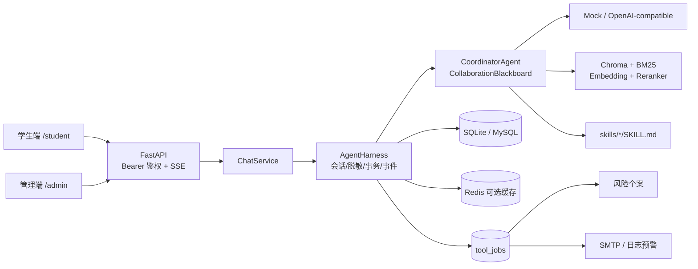

# MindNook 技术文档

> 文档版本：2.0
> 更新日期：2026-08-24
> 事实来源：当前工作区代码、自动化测试与 `.env.example`

## 1. 系统概述

MindNook 是一个前后端一体的校园心理支持 Web 应用，包含学生注册与对话、管理员工作台、多智能体协作、本地心理知识检索、SQL 心理台账、风险个案、预警、按需 Excel 导出和审计 Trace。

项目默认以 SQLite、Mock Model Provider 运行；Redis 不可用时短期记忆会从业务数据库回填。完整基础设施模式可切换到 MySQL、Redis 和 OpenAI-compatible 模型服务。Chroma 保存可重建的本地向量索引。

## 2. 技术栈

| 模块 | 当前实现 |
|---|---|
| 后端 | Python 3.11+、FastAPI、Uvicorn |
| 前端 | 原生 HTML、CSS、JavaScript |
| ORM 与业务数据库 | SQLAlchemy；默认 SQLite，可配置 MySQL/PyMySQL |
| 短期与 Agent 私有记忆 | Redis；测试或 `memory://` 使用内存兼容 Store，连接失败时降级 |
| 模型 | 确定性 Mock；OpenAI-compatible `/chat/completions` API；`bailian` 为兼容别名 |
| 智能体编排 | `CoordinatorAgent` + 追加式 `CollaborationBlackboard` |
| 知识检索 | Markdown、Chroma、FastEmbed BGE Embedding、BM25、BGE Cross-Encoder |
| 流式协议 | Server-Sent Events；候选内容审查后才公开分片 |
| 后台任务 | 数据库持久化 `tool_jobs` + 进程内轮询线程和分类线程池 |
| 文件与通知 | openpyxl、SMTP/日志预警 |
| 工具协议 | FastMCP stdio Server，5 个工具 |
| 测试 | pytest/unittest、FastAPI TestClient、隔离 Engineering Harness、RAG Evaluation |

## 3. 总体架构



代码边界：

- `app/api`：认证、授权、请求校验、管理接口和 SSE 编码。
- `app/services/chat.py`：只转发 `AgentHarness` 的公开事件。
- `app/harness/agent_harness.py`：会话归属、幂等、脱敏、记忆装配、Runtime 调用、最终事务和工具计划。
- `app/agents`：不访问 FastAPI 或 SQLAlchemy 的多智能体推理与黑板协议。
- `app/memory`：短期记忆、Agent 私有记忆和审计 Trace。
- `app/rag`：知识切块、向量/BM25 召回、融合、重排、扩展和评测。
- `app/services/jobs.py`、`app/services/tool_dispatcher.py`、`app/tools/operations.py`：持久化任务和可复用业务操作。
- `app/models.py`：当前数据库实体；项目没有独立 Repository 层或 Alembic 迁移目录。
- `app/static`：学生端和管理端页面。

## 4. 单轮聊天流程

1. HTTP 层验证 Bearer Token、学生角色和请求 Schema，构造 `ChatCommand`。
2. Harness 验证会话归属，并以 `(conversation_id, client_request_id)` 检查重复请求。
3. 当前输入先做 PII 脱敏；短期历史从 Redis 读取，未命中或故障时从业务数据库回填。
4. Harness 先保存 `status=generating` 的学生原始消息和脱敏副本。
5. Coordinator 执行固定安全规则；Understanding、Safety、Context、Response Agent 通过黑板任务与 Artifact 完成规划。
6. ResponseAgent 从 Provider 接收内部候选流；该流只产生内部进度事件，不直接发送给学生。
7. SafetyAgent 审查完整候选；拒绝时最多修复一次，失败或超预算时采用固定回退回复。
8. Harness 在最终事务中保存助手消息、Agent Run/Steps、协作事件、完整 Trace、心理报告和 `ToolJob`。
9. 事务提交后更新 Redis/私有记忆并唤醒 Dispatcher；最终安全回复再按 28 个字符形成公开 `delta`，随后发送 `completed`。

最终业务规则：

| `risk_level` | 心理 RAG | 报告 | SQL 台账 | 个案 | 预警 |
|---|---:|---:|---:|---:|---:|
| `CHAT` | 否 | 否 | 否 | 否 | 否 |
| `CONSULT` | 是 | 是 | 是 | 否 | 否 |
| `RISK` | 是，含固定安全主题/名额 | 是 | 是 | 是 | 是 |

## 5. 多智能体 Runtime

| 组件 | 当前职责 |
|---|---|
| `CoordinatorAgent` | 创建 root task、执行固定规则、派生任务、控制预算、处理降级并发布 `FINAL_ADOPTED` |
| `UnderstandingAgent` | 输出 `IntentAnalysis`；失败时使用固定规则意图 |
| `SafetyAgent` | 对 `CONSULT/RISK` 输入做风险评估，并审查每版候选回复 |
| `ContextAgent` | 使用预先构造的 `MemoryContext`，按最终风险触发 RAG 并选择 Skill |
| `ResponseAgent` | 组装 Prompt、流式生成候选，并在审查拒绝时执行一次修复 |

默认预算为 16 个协作轮次、7 次模型调用、55 秒单轮总时限、20 秒单次模型请求超时。风险顺序为 `CHAT < CONSULT < RISK`；固定规则命中的 `RISK` 不能被模型降级。

## 6. 数据、记忆与审计

业务数据库当前保存：

- `users`、`conversations`、`chat_messages`；
- `psychological_reports`、`risk_cases`、`case_events`；
- `ledger_entries`、`alert_deliveries`、`alert_events`；
- `tool_jobs`、`dead_letter_records`；
- `agent_runs`、`agent_steps`、`agent_collaboration_events`、`agent_run_traces`；
- `audit_logs`。

知识 Chunk 不写入业务数据库：Markdown 位于 `data/knowledge`，向量写入 Chroma，Chunk 元数据和 BM25 索引保存在 RAG 服务进程内存中。

Redis 默认保存最近 40 条脱敏消息，TTL 86400 秒。模型上下文保留最近 8 条带角色原文并受 6000 字符预算限制；更早的已加载历史按确定性 4/3/1 规则形成最多 500 字符的 `memoryBrief`。各 Agent 使用 `agent:<AgentName>:<session_public_id>` 隔离私有记忆。

`agent_run_traces` 包含原始/脱敏输入、记忆、检索结果、完整 Tasks、Artifacts 和 Agent Messages。Artifact 中可能含回复 Prompt 与候选正文，因此 Trace 是高敏感审计数据，不是普通运行日志。

## 7. 知识检索

RAG 只扫描 `data/knowledge` 第一层的 UTF-8 Markdown。默认流程：

1. 以 512 字符、64 字符重叠切块，并尽量在段落或中文标点边界结束。
2. FastEmbed `BAAI/bge-small-zh-v1.5` 写入 512 维 Chroma Collection。
3. 同时执行向量召回和 BM25，按 `0.75 / 0.25` 归一化融合。
4. 使用 `BAAI/bge-reranker-base` Cross-Encoder 与融合分各占 `0.5` 重排。
5. 扩展首个选中块的同文档前后块，并优先保留不同来源，默认返回 3 条。
6. `RISK` 查询加入固定安全主题，并固定纳入《安全风险与危机支持边界》来源。

索引在首次 `status()`、`retrieve()` 或 `rebuild()` 时懒加载；知识文件名、修改时间或大小变化会触发重建。Embedding/Reranker/Chroma 发生异常时，ContextAgent 捕获错误并降级到少量内置关键词知识。当前管理端只支持查看状态/来源和触发重建，不支持通过 API 上传、编辑、停用、删除知识或管理快照。

## 8. SQL 台账、后台任务、个案与预警

Harness 在最终事务内创建以下持久化任务：

```text
CONSULT → 无后台任务
RISK    → CASE_CREATE + ALERT_SEND
              └───────────────↑ depends_on
```

任务状态为 `PENDING / RUNNING / SUCCESS / DEAD`，具备唯一幂等键、优先级、依赖、指数退避、启动恢复和死信记录。生产式环境使用 `ThreadedToolDispatcher`；`app_env=test` 使用同步排空的 `InlineToolDispatcher`。

- `PsychologicalReport` 保存台账详细数据，`LedgerEntry` 保存唯一登记标记，两者在最终结果事务中一起提交。
- 管理员下载 Excel 时从 SQL 查询数据并在内存中即时生成响应，不维护常驻工作簿。
- `CASE_CREATE` 仅处理 `RISK` 报告；同一报告最多一个个案。
- `ALERT_SEND` 只有在个案任务成功后才能领取。
- SMTP 基本配置不完整时使用 `log` 渠道；支持 STARTTLS 或隐式 SSL。
- 预警线程池使用进程内每分钟滑动窗口限流，默认 10 次。

FastMCP stdio Server 复用同一 `ToolOperations`，暴露建案、发预警、确认预警、追加个案备注和再次通知 5 个工具。

## 9. 认证、授权与 CORS

- 密码使用 PBKDF2-HMAC-SHA256，随机 16 字节 Salt，默认 210,000 次迭代。
- 登录返回自定义的 HMAC-SHA256 签名 Bearer Token，载荷包含用户公共 ID、角色和过期时间；它不是 JWT，默认有效期 8 小时。
- 服务端每次请求都会复核用户存在、`status=active` 且角色与 Token 一致。
- 当前仅有 `student`、`admin` 两种角色，没有更细的数据范围或组织级权限。
- 当前没有服务端 logout、Token 撤销/刷新、登录失败锁定、MFA 或 SSO；前端退出只清除本地 Token。
- CORS 当前 `allow_origins=[]`，只声明 GET/POST 与 Authorization/Content-Type；同源静态页面不依赖跨域访问。

## 10. 当前 API

公共与学生接口：

| 方法 | 路径 | 说明 |
|---|---|---|
| `POST` | `/api/v1/auth/register/student` | 注册学生并直接返回 Token |
| `POST` | `/api/v1/auth/login` | 学生或管理员登录 |
| `GET` | `/api/v1/me` | 当前用户 |
| `POST` | `/api/v1/conversations` | 创建学生会话 |
| `GET` | `/api/v1/conversations` | 列出本人会话 |
| `GET` | `/api/v1/conversations/{conversation_id}/messages` | 列出本人会话消息 |
| `POST` | `/api/v1/conversations/{conversation_id}/messages:stream` | SSE 聊天 |
| `GET` | `/health/live` | 存活状态 |
| `GET` | `/health/ready` | 组件声明状态；当前不主动探测依赖 |

管理接口均要求 `admin`：

| 分组 | 路径 |
|---|---|
| 用户 | `GET /api/v1/admin/users`、`POST /api/v1/admin/users/admins` |
| 概览 | `GET /api/v1/admin/dashboard/summary` |
| 报告 | `GET /api/v1/admin/reports`、`GET /api/v1/admin/reports/{report_id}/context` |
| 个案 | `GET /api/v1/admin/cases`、`POST .../assign`、`POST .../notes`、`POST .../transitions`、`GET .../events` |
| 审计 | `GET /api/v1/admin/audit-logs` |
| 导出 | `GET /api/v1/admin/exports/{reports|cases|audit-logs}.xlsx` |
| 预警/任务 | `GET /api/v1/admin/alerts`、`GET /api/v1/admin/job-groups`、`POST /api/v1/admin/job-groups/{report_id}/retry`；`GET /api/v1/admin/jobs` 保留为底层任务诊断接口 |
| Agent | `GET /api/v1/admin/agent-runs`、`GET .../steps`、`GET .../events`、`GET .../trace` |
| Skills | `GET /api/v1/admin/skills` |
| 知识 | `GET /api/v1/admin/knowledge/status`、`GET .../sources`、`POST .../index/rebuild` |

报告接口当前只支持可选 `risk_level` 精确筛选；个案状态筛选、报告/个案分页由前端对已加载列表执行。审计日志接口支持服务端 action/resource/actor 筛选和分页。

## 11. 配置与部署

`app/core/config.py` 提供代码默认值；`.env.example` 是 MySQL + Redis 的完整基础设施示例，两者不能混为同一套默认配置。常用设置包括：

- `DATABASE_URL`、`REDIS_URL` 和 Redis 连接超时；
- 短期/私有记忆条数、TTL 和上下文字符预算；
- Embedding、Chroma、BM25 融合、Reranker 与 Top K；
- 模型 Provider、模型名称、超时、重试、调用/轮次预算；
- 工具 Worker 并发、重试、恢复和预警限流；
- SMTP 主机、端口、认证、发件人、接收人、TLS/SSL；
- 本地演示账号和 Token TTL（后者当前只在代码中定义）。

`docker-compose.yml` 只启动 MySQL 8.4 和 Redis 7.4。Python 后端始终在宿主机运行，仓库没有后端 Dockerfile。轻量模式可直接使用默认 SQLite + Mock；完整模式复制 `.env.example` 后启动 MySQL/Redis，再运行：

```bash
uvicorn app.main:app --reload --port 8080
```

应用 lifespan 会执行两段兼容迁移、`Base.metadata.create_all()`、演示账号 Seed、交接摘要回填并启动工具 Dispatcher。当前没有 Alembic 或独立生产迁移命令。

## 12. 测试与评测

```bash
# 全部测试
python -m pytest -q

# 六类隔离工程验证
python -m app.harness.runner
python -m app.harness.runner --json

# RAG 回归与发布阈值
python -m app.rag.evaluation
python -m app.rag.evaluation --evaluate-answers --strict
```

Engineering Harness 使用临时 SQLite、内存 Redis 兼容 Store、Mock Provider、Hash Embedding 和关闭 Reranker 的临时 Chroma，因此不验证真实 MySQL、真实 Redis、BGE 模型或浏览器 UI。当前隔离环境没有显式清空从进程环境/`.env` 继承的 SMTP 配置；三项 SMTP 基本字段已配置时，`tool-queue` 套件可能尝试真实邮件连接，不能把该命令视为完全无外部副作用。仓库内当前 RAG 报告基于正式 BGE 配置，严格门禁仍因 Recall@3 未达到 0.95 而失败。

## 13. 当前实现边界

- 项目用于本地开发和封闭演示，不应直接承载真实危机干预。
- 管理端知识能力是只读状态/来源和重建，不包含上传、审核、发布、停用、删除或快照回滚。
- 没有独立运营、咨询师、审计员角色，也没有资源级数据范围授权。
- 没有服务端 Token 撤销/刷新、登录限速、MFA/SSO、CSRF/CSP 或正式密钥管理。
- 数据库敏感正文和 Trace 当前未做字段级加密；按需 Excel 导出可能包含敏感原文或摘要。
- readiness 返回声明性 `ready`，不探测数据库、Redis、模型或 RAG 的实时可用性。
- 工具 Worker 和预警限流均在 Web 进程内；多应用副本场景尚未完成共享租约和共享限流设计。
- 管理端可以按报告流程重新执行失败步骤，但尚无预警确认/再次通知 API；预警确认和再次通知目前只通过 MCP 业务操作暴露。
- 当前没有独立的服务端取消 API 或协作式取消令牌；浏览器使用 `AbortController` 中止本次 HTTP 读取。
- 真实模型、真实基础设施、浏览器 E2E、并发压测、备份恢复和专业人工评审仍需单独完成。
