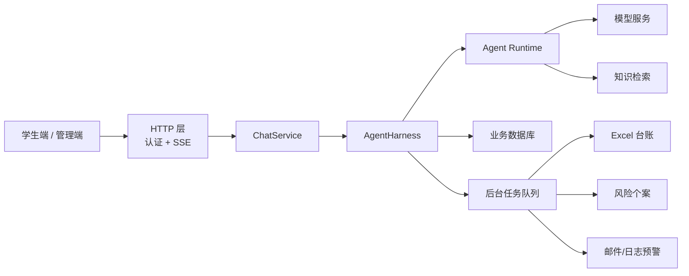

# MindNook 技术文档

> 文档版本：1.0  
> 更新日期：2026-07-30

## 1. 系统概述

MindNook 是一个前后端一体的校园心理关怀 Web 应用，包含学生对话端、管理员后台、智能体协作、心理知识库、风险评估和异步预警等能力。

系统采用 Python 后端与原生 Web 前端，支持本地模型和 OpenAI-compatible 模型，并使用 MySQL、Redis 和 Chroma 分别保存业务数据、短期记忆和向量知识。

## 2. 技术栈

| 模块 | 技术 |
|---|---|
| 后端 | Python、FastAPI、Uvicorn |
| 前端 | HTML、CSS、JavaScript |
| 业务数据库 | MySQL、SQLAlchemy |
| 短期记忆 | Redis |
| AI大模型 | 阿里百炼大模型 API |
| 智能体编排 | 事件驱动多智能体协作 |
| 知识检索 | Chroma、Embedding、BM25、本地重排 |
| 流式响应 | Server-Sent Events |
| 后台任务 | 进程内任务队列与线程池 |
| 文件与通知 | openpyxl、SMTP、MCP |
| 部署 | Docker、Docker Compose |

## 3. 总体架构



核心分层：

- `app/api`：HTTP 认证、请求 Schema 和 SSE，不编排聊天业务。
- `app/services/chat.py`：只转发 AgentHarness 的公开事件。
- `app/harness`：会话解析、输入脱敏、Runtime 调用、消息/报告/Trace 落库与工具计划。
- `app/agents`：无 HTTP、无数据库依赖的事件驱动多 Agent Runtime。
- `app/services`：模型网关、后台任务和工具执行服务。
- `app/models`：数据库实体。
- `app/schemas`：接口数据结构。
- `app/static`：学生端、管理端和登录页面。
- `app/knowledge`：内置心理知识。
- `skills`：标准心理支持规则。

## 4. 核心处理流程

学生发送消息后，系统依次完成：

1. HTTP 层认证学生并把请求转换为 `ChatCommand`。
2. ChatService 调用 AgentHarness，Harness 解析会话、检查幂等并脱敏模型输入。
3. CoordinatorAgent 创建 CollaborationBlackboard；专业 Agent 按 capability claim task 并追加 artifact/message/event。
4. Harness 消费 Provider 的内部模型流，Runtime 对完整候选执行安全审查。
5. Harness 保存学生消息、助手消息、报告、智能体轨迹和持久化工具任务。
6. ChatService 只把安全成品的公开事件交给 HTTP 层，通过 SSE 返回。
7. 事务提交后异步写 Excel 台账、创建风险个案和发送预警。

普通交流跳过心理知识检索和心理报告。明确的自伤、自杀等高风险词由固定规则优先识别，不完全依赖模型。

## 5. 多智能体模块

Agent Runtime 采用事件驱动多智能体协作，由以下角色组成：

| 智能体 | 职责 |
|---|---|
| CoordinatorAgent | 创建 root task、派生缺失工作、控制预算并最终采纳 |
| UnderstandingAgent | 判断意图和主题 |
| SafetyAgent | 评估输入风险、发布安全覆盖并审查候选回复 |
| ContextAgent | 加载记忆、知识和 Skills |
| ResponseAgent | 生成候选回复，并在需要时执行一次修复 |

Agent 之间不互相调用方法。它们通过冻结的 AgentTask、AgentArtifact、AgentMessage、AgentEvent 和 AgentTurnResult 协作，历史只追加不覆盖。AgentHarness 只编排 Runtime 和业务副作用，不参与推理决策；Runtime 不读取数据库、不创建报告，也不调用业务工具。


## 6. 数据与记忆

MySQL 保存：

- 用户和角色。
- 会话及完整消息。
- 知识分块。
- 心理报告和风险个案。
- 个案备注。
- 预警、Excel 和后台任务记录。
- 智能体轨迹、死信和工具审计。
- CollaborationBlackboard 追加式事件序列。

Redis 使用 `mindbridge:short-term-memory:<session_public_id>` 保存最近 40 条脱敏消息，TTL 为 86400 秒。Redis 未命中或不可用时，从 MySQL `chat_messages` 回填最近 40 条。

长会话将较早历史压缩为最多 1200 字符的 `memoryBrief`，并保留最近 8 条带角色脱敏原文作为受 6000 字符预算约束的 `modelHistory`。手机号、邮箱和身份证号等信息在进入模型和短期记忆前进行脱敏。

各 Agent 使用 `agent:<AgentName>:<session_public_id>` 隔离私有记忆；审计型记忆写入 `agent_run_traces`，不会回流到下一轮 Prompt。

## 7. 知识检索

内置知识以 Markdown 保存，应用启动时同步到数据库。

检索流程：

1. 将文档切分为重叠文本块。
2. 同时执行向量检索与 BM25 关键词检索。
3. 融合两路得分并进行本地重排。
4. 返回最相关内容及相邻上下文。

管理员可上传 PDF、Markdown 和 TXT，重建向量索引并创建快照。

当向量服务不可用时，系统自动回退到 BM25 和本地词面检索；高风险安全判断不依赖知识库。

## 8. 风险报告与后台任务

处理规则：

| 场景 | 报告 | Excel | 个案 | 预警 |
|---|---:|---:|---:|---:|
| 普通交流 | 否 | 否 | 否 | 否 |
| 低风险心理支持 | 是 | 是 | 否 | 否 |
| 中风险 | 是 | 是 | 是 | 否 |
| 高风险 | 是 | 是 | 是 | 是 |

后台任务具有幂等、依赖、重试和死信机制：

- Excel 任务负责写入风险台账。
- 中高风险任务创建个案。
- 高风险预警在个案创建成功后发送。
- 任务多次失败后写入死信，供管理员处理。
- 服务重启后会恢复未完成任务。

通知支持日志模式和 SMTP 邮件模式。关闭队列时，也可以通过 MCP 工具执行相同操作。

## 9. 认证与权限

接口登录后使用 Bearer Token，系统区分学生和管理员角色：

- 学生可以查看个人资料、模型状态并发起聊天。
- 管理员可以查看报告、个案、会话、知识库和运行记录。
- 管理员账号不能发起学生聊天。
- 会话与用户绑定，学生不能访问他人会话。

当前密码摘要方式和默认演示账号仅适合本地演示；生产环境应更换为安全密码算法、正式登录会话和更严格的管理员认证。

## 10. 主要接口

| 接口类型 | 主要能力 |
|---|---|
| 健康检查 | 返回服务状态 |
| 用户接口 | 当前资料、模型与智能体状态 |
| 学生接口 | SSE 流式聊天、个人报告数据 |
| 报告接口 | 报告列表和相关会话 |
| 个案接口 | 个案列表、备注读取与新增 |
| 知识库接口 | 上传、状态、重建和备份 |
| 运维接口 | 工具任务、死信、智能体轨迹和工具审计 |

所有管理接口均要求管理员权限。

## 11. 配置与部署

主要配置分为：

- 模型 Provider、模型名称和生成参数。
- 数据库和 Redis 连接。
- 智能体运行模式与执行预算。
- 知识分块、检索权重和向量库路径。
- 后台任务并发、重试和限流。
- Excel 路径和邮件通知参数。

Docker Compose 只启动 MySQL 和 Redis。Python 后端在宿主机通过 Uvicorn 运行并监听 `8080`，不构建进 Docker。

本地开发可使用 Mock 模型；真实运行可切换到 Ollama 本地模型或 OpenAI-compatible API。

## 12. 测试

项目包含：

- 单元测试：多智能体协议、记忆压缩、隐私脱敏、风险硬规则、Skills 和工具治理。
- 工程 Harness：不启动 HTTP 即可验证脱敏、会话、聊天路由、消息/报告落库、Trace 和工具任务。
- RAG 评测：输出 Recall@K、Precision@K、MRR、NDCG 和 Hit Rate。

运行单元测试：

```bash
python -m unittest discover -s tests
```

运行工程 Harness：

```bash
python -m app.harness.runner
```

## 13. 技术注意事项

- 生产环境应替换 Basic Auth、默认账号和简单密码摘要。
- 工具治理策略需要确保真正接入每次任务执行。
- 学生原始对话、报告和运行轨迹属于高敏感数据，应限制保存范围和访问权限。
- 上传文件应增加大小、类型和内容安全限制。
- 生产环境应限制 CORS 来源。
- 向量库、Redis、邮件等外围能力故障时，不应阻断基础聊天和高风险安全回复。
